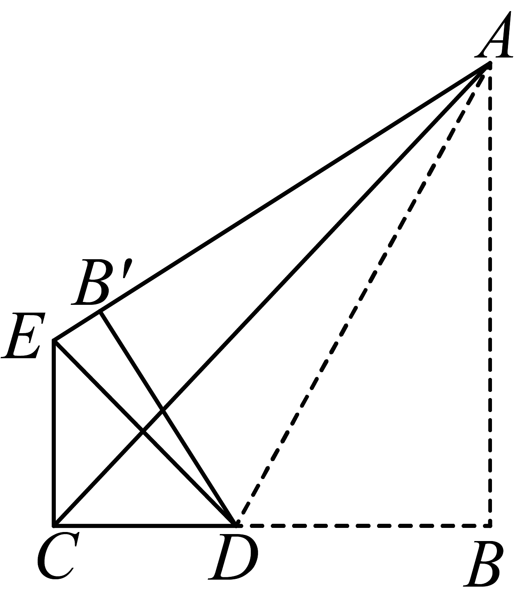

10. （2025八上·海淀期中）如图，在 $\mathrm{Rt}\triangle ABC$ 中，$\angle B=90^{\circ}$，$AB=BC$。点 $D$ 是边 $BC$ 上的一点且 $\angle ADB=60^{\circ}$，将 $\mathrm{Rt}\triangle ABC$ 沿直线 $AD$ 折叠，使点 $B$ 落到点 $B'$ 的位置，延长 $AB'$ 到点 $E$，使 $AE=AD$，连接 $DE$、$CE$。则下列结论：$①$ $\angle B'DE=15^{\circ}$ $②$ $DE\perp AC$ $③$ $CE\parallel AB$ $④$ $\angle AEC=120^{\circ}$ 其中正确的个数是（ ）

A. 1

B. 2

C. 3

D. 4

> [!question]- 点击查看答案与解析
> 【答案】D
> 
> 【考点】三角形内角和 → [[【初中数学知识点体系-人教版】#13-3 三角形的内角与外角]]、折叠的全等性质 → [[【初中数学知识点体系-人教版】#14-1 全等三角形及其性质]]、等腰三角形 → [[【初中数学知识点体系-人教版】#15-3 等腰三角形]]
> 
> 【解析】
> 由 $\angle B=90^{\circ}$、$AB=BC$ 得 $\angle BAC=\angle C=45^{\circ}$；由 $\angle ADB=60^{\circ}$ 得 $\angle BAD=30^{\circ}$。
> 沿 $AD$ 折叠后 $\angle B'AD=\angle BAD=30^{\circ}$，$\angle ADB'=\angle ADB=60^{\circ}$，$AB'=AB$，故 $\angle B'AB=60^{\circ}$。
> 因 $E$ 在 $AB'$ 的延长线上且 $AE=AD$，$\angle DAE=\angle B'AD=30^{\circ}$，等腰 $\triangle ADE$ 中 $\angle ADE=\angle AED=75^{\circ}$。
> $①$ $\angle B'DE=\angle ADE-\angle ADB'=75^{\circ}-60^{\circ}=15^{\circ}$，正确；
> $②$ $\angle ADC=180^{\circ}-\angle ADB=120^{\circ}$，$\angle CDE=\angle ADC-\angle ADE=120^{\circ}-75^{\circ}=45^{\circ}$，而 $\angle DCA=45^{\circ}$，两角分居 $DC$ 两侧，故 $\angle(DE,CA)=90^{\circ}$，即 $DE\perp AC$，正确；
> $③$ $\triangle DCE$ 中 $\angle CDE=45^{\circ}$、$\angle DCE=90^{\circ}$，故 $\angle DEC=45^{\circ}$，于是 $\angle AEC=\angle AED+\angle DEC=75^{\circ}+45^{\circ}=120^{\circ}$（$④$ 正确）；
> 又 $\angle CAE=\angle B'AC=\angle B'AB-\angle BAC=60^{\circ}-45^{\circ}=15^{\circ}$，故 $\angle ACE=180^{\circ}-120^{\circ}-15^{\circ}=45^{\circ}=\angle BAC$，内错角相等，得 $CE\parallel AB$，正确。
> 四个结论都正确，共 4 个，综上，选 D。
> 
> 【易错点】折叠只保证长度和角相等，不保证位置关系；忽略“$E$ 在 $AB'$ 的延长线上、$AE>AB'$”，把 $\angle DAE$ 取成 $60^{\circ}$ 就会全盘算错。
