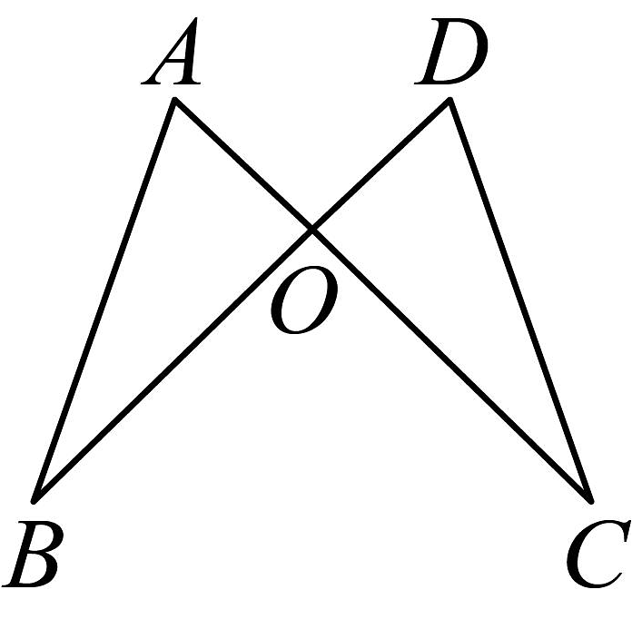

11. （2025八上·海淀期中）如图，已知 $AB=DC$，若要判定 $\triangle ABO\cong \triangle DCO$，则只需添加一个适当的条件是 ___ 。

> [!question]- 点击查看答案与解析
> 【答案】$\angle A=\angle D$（填 $\angle B=\angle C$ 也可）
> 
> 【考点】全等三角形的判定（AAS） → [[【初中数学知识点体系-人教版】#14-2 三角形全等的判定]]
> 
> 【解析】
> 已有 $AB=DC$（$AB$ 与 $DC$ 是对应边），$\angle AOB=\angle DOC$（对顶角，是对应角）。
> 注意 $AB$ 恰好是 $\angle AOB$ 的对边，两已知元素不是“夹角＋夹边”，所以不能用 $SAS$；
> 只能补一组对应角，用 $AAS$：$\angle A=\angle D$（或 $\angle B=\angle C$），此时 $\triangle ABO\cong\triangle DCO$。
> （若补 $AO=DO$ 或 $BO=CO$，得到的是“边边角”，不能判定全等。）
> 
> 【易错点】看到两个三角形有公共顶点就顺手填 $AO=DO$ 用 $SAS$，没有核对 $AB$ 是否为夹角的两边。
