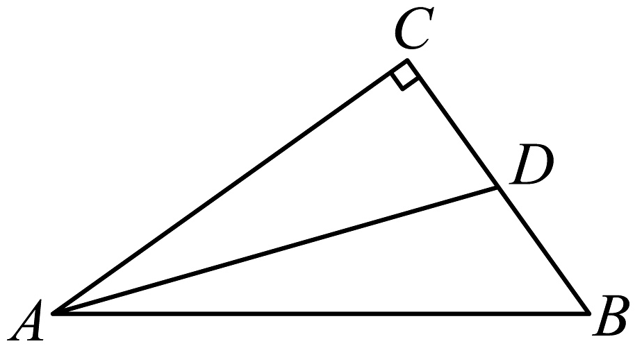

13. （2025八上·海淀期中）如图，在 $\triangle ABC$ 中，$\angle C=90^{\circ}$，$AD$ 平分 $\angle CAB$ 交 $BC$ 于点 $D$，若 $DC=5$，$AB=12$，则 $\triangle ABD$ 的面积为 ___ 。

> [!question]- 点击查看答案与解析
> 【答案】30
> 
> 【考点】角平分线的性质 → [[【初中数学知识点体系-人教版】#14-3 角的平分线]]
> 
> 【解析】
> $AD$ 平分 $\angle CAB$，由角平分线上的点到角两边距离相等，$D$ 到 $AB$ 的距离等于 $DC=5$。
> 取 $AB$ 为底，$S_{\triangle ABD}=\dfrac{1}{2}\cdot AB\cdot 5=\dfrac{1}{2}\times12\times5=30$。
> 
> 【易错点】把 $DC$ 直接当作 $\triangle ABD$ 的高（$DC\perp BC$ 而非 $\perp AB$），或用 $\dfrac{1}{2}\cdot AB\cdot BC$ 去算。
