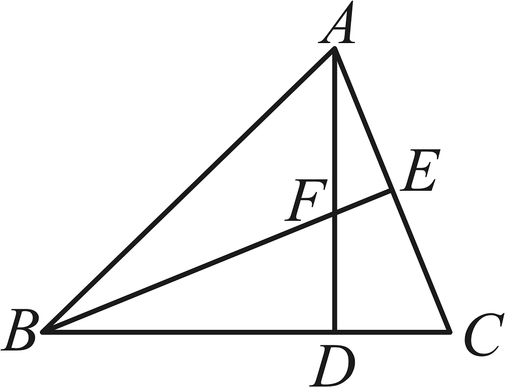

14. （2025八上·海淀期中）如图，在 $\triangle ABC$ 中，$AD$ 是 $BC$ 边上的高，$BE$ 是 $AC$ 边上的高，且 $AD$，$BE$ 交于点 $F$，若 $BF=AC$，$CD=4$，$BD=9$，$AF$ 的长为 ___ 。

> [!question]- 点击查看答案与解析
> 【答案】5
> 
> 【考点】全等三角形的判定与性质 → [[【初中数学知识点体系-人教版】#14-2 三角形全等的判定]]、三角形的高 → [[【初中数学知识点体系-人教版】#13-2 与三角形有关的线段]]
> 
> 【解析】
> $AD\perp BC$，$BE\perp AC$，故 $\angle BDF=\angle ADC=90^{\circ}$；
> 又 $\angle DBF=90^{\circ}-\angle C=\angle DAC$，且 $BF=AC$，
> 所以 $\triangle BDF\cong\triangle ADC$（$AAS$），得 $BD=AD=9$，$DF=DC=4$。
> 故 $AF=AD-DF=9-4=5$。
> 
> 【易错点】对应边配错（应是 $BD\leftrightarrow AD$、$DF\leftrightarrow DC$）；把 $AF$ 当作 $AD$ 或把 $BF$ 当作 $AD$。
