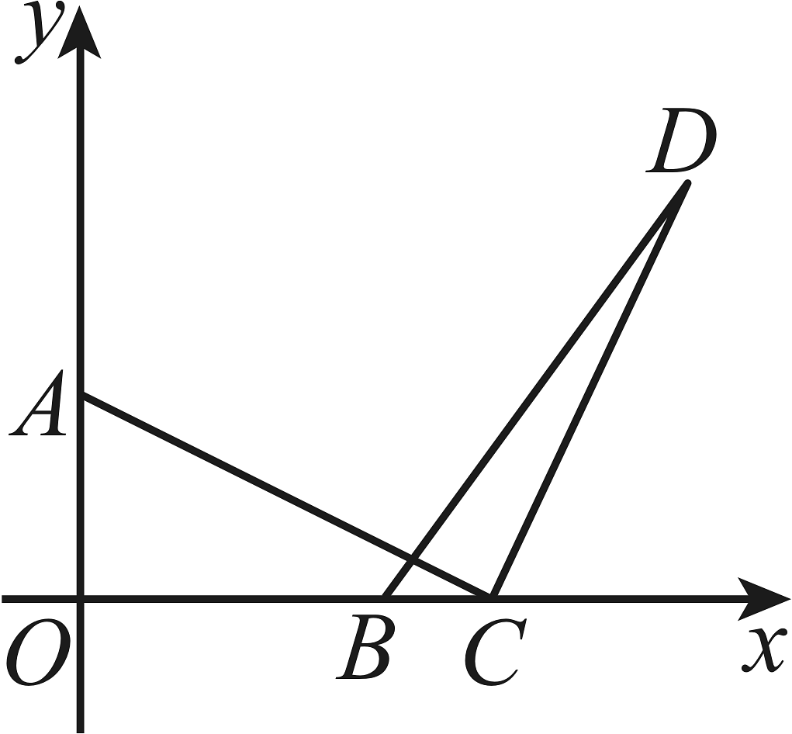

16. （2025八上·海淀期中）如图，在平面直角坐标系中，点 $A$ 的坐标为 $(0,4)$，点 $B$ 的坐标为 $(6,0)$，点 $C$ 是 $x$ 轴正半轴上的一个动点。连接 $AC$，过点 $C$ 作 $CD\perp AC$，且 $CD=AC$，连接 $BD$

（1）设点 $C$ 的坐标为 $(t,0)$，则点 $D$ 的坐标为 ___ 。

（2）当线段 $BD$ 取最小值时，点 $C$ 的坐标为 ___ 。

> [!question]- 点击查看答案与解析
> 【答案】（1）$(t+4,t)$；（2）$(1,0)$
> 
> 【考点】等腰直角三角形的构造 → [[【初中数学知识点体系-人教版】#15-3 等腰三角形]]、全等的转化 → [[【初中数学知识点体系-人教版】#14-2 三角形全等的判定]]
> 
> 【解析】
> （1）由 $A(0,4)$、$C(t,0)$ 得 $\overrightarrow{AC}=(t,-4)$。$CD\perp AC$ 且 $CD=AC$，把 $\overrightarrow{AC}$ 绕 $C$ 逆时针转 $90^{\circ}$ 得 $\overrightarrow{CD}=(4,t)$（图中 $D$ 在 $AC$ 的右上方），
> 所以 $D$ 的坐标为 $(t+4,\,t)$。
> （2）$B(6,0)$，则 $BD^{2}=(t+4-6)^{2}+t^{2}=(t-2)^{2}+t^{2}=2t^{2}-4t+4$，
> 当 $t=1$ 时取最小值，此时 $BD=\sqrt{2}$（最小），
> 所以点 $C$ 的坐标为 $(1,0)$。
> 
> 【易错点】旋转方向取反，得成 $(t-4,-t)$（$D$ 落在 $x$ 轴下方）；配方时把对称轴错算成 $t=2$。
