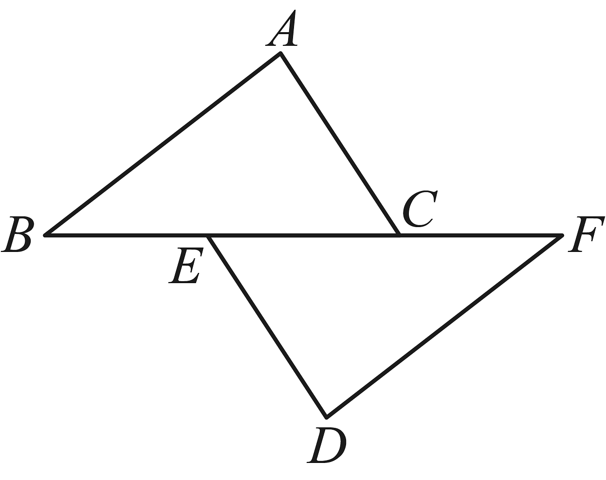

18. （2025八上·海淀期中）如图，点 $B$，$E$，$C$，$F$ 在一条直线上，$AB=DF$，$AC=DE$，$BE=CF$，求证：$\triangle ABC\cong \triangle DFC$。

> [!question]- 点击查看答案与解析
> 【答案】证明见解析（$SSS$）
> 
> 【考点】全等三角形的判定（SSS） → [[【初中数学知识点体系-人教版】#14-2 三角形全等的判定]]
> 
> 【解析】
> 由 $BE=CF$，两边同加 $EC$ 得 $BE+EC=CF+EC$，即 $BC=EF$。
> 在 $\triangle ABC$ 与 $\triangle DFC$ 中：$AB=DF$，$AC=DE$，$BC=FC$，
> 所以 $\triangle ABC\cong\triangle DFC$（$SSS$）。
> 
> 【易错点】直接把 $BE=CF$ 当三角形的一边；等式相加时忘记加公共段 $EC$，导致 $BC$ 与 $FC$ 无法对应。
