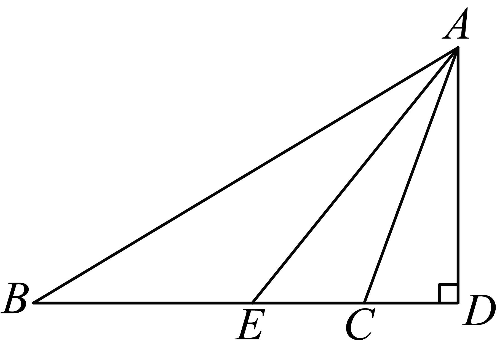

19. （2025八上·海淀期中）如图，在 $\triangle ABC$ 中，$AD\perp BC$ 于点 $D$，$AE$ 平分 $\angle BAC$，交 $BC$ 于点 $E$，若 $\angle B=30^{\circ}$，$\angle ACD=70^{\circ}$，求 $\angle DAE$ 的大小。

> [!question]- 点击查看答案与解析
> 【答案】$20^{\circ}$
> 
> 【考点】三角形内角和 → [[【初中数学知识点体系-人教版】#13-3 三角形的内角与外角]]、角平分线 → [[【初中数学知识点体系-人教版】#14-3 角的平分线]]、高线 → [[【初中数学知识点体系-人教版】#13-2 与三角形有关的线段]]
> 
> 【解析】
> $\angle ACB=\angle ACD=70^{\circ}$，$\angle B=30^{\circ}$，故 $\angle BAC=180^{\circ}-30^{\circ}-70^{\circ}=80^{\circ}$。
> $AE$ 平分 $\angle BAC$，$\angle BAE=\dfrac{1}{2}\angle BAC=40^{\circ}$。
> $AD\perp BC$，在 $\mathrm{Rt}\triangle ABD$ 中 $\angle BAD=90^{\circ}-30^{\circ}=60^{\circ}$。
> 所以 $\angle DAE=\angle BAD-\angle BAE=60^{\circ}-40^{\circ}=20^{\circ}$。
> 
> 【易错点】把 $\angle ACD$ 当作与 $\angle ACB$ 无关的角，算不出 $\angle BAC$；用 $\angle DAC=90^{\circ}-70^{\circ}$ 后就以为 $\angle DAE=\angle DAC$。
