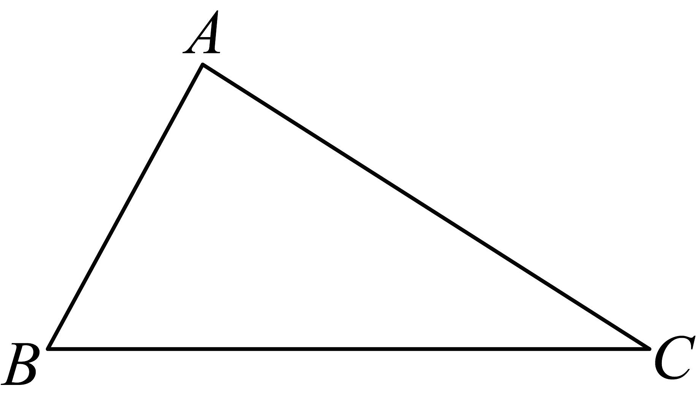
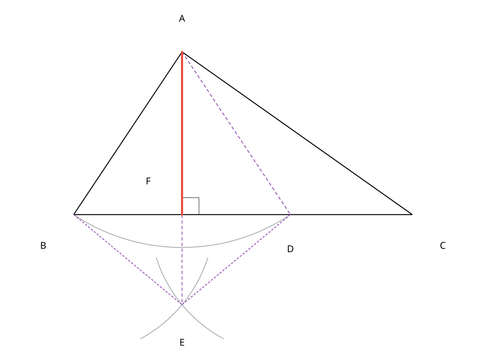

20. （2025八上·海淀期中）阅读材料并解决问题：

已知：在 $\triangle ABC$ 中，$AB<BC$。求作：$BC$ 边上的高线 $AF$。

作法：$①$ 以点 $A$ 为圆心，$AB$ 的长为半径作弧，交 $BC$ 边于点 $D$，连接 $AD$；$②$ 分别以点 $B$ 和点 $D$ 为圆心，大于 $\frac{1}{2}BD$ 的长为半径作弧，两弧在 $BD$ 下方相交于点 $E$；$③$ 作射线 $AE$ 交 $BD$ 于点 $F$。所以线段 $AF$ 即为 $\triangle ABC$ 的 $BC$ 边上的高线。

（1）使用无刻度直尺和圆规，补全图形（保留作图痕迹）；

（2）完成下面的证明。

证明：连接 $BE$ 和 $DE$。

在 $\triangle ABE$ 和 $\triangle ADE$ 中，

$AB=$ ___ ，

$BE=DE$，

$AE=AE$，

$\therefore \triangle ABE\cong\triangle ADE(\mathrm{SSS})$。

$\therefore \angle BAE=\angle DAE$，

$\therefore AF$ 平分 $\angle BAD$，

$\therefore$ ___ $\perp$ ___ ，（ ___ ）（填写推理的依据）

即 $AF$ 为 $\triangle ABC$ 的 $BC$ 边上的高线。

> [!question]- 点击查看答案与解析
> 【答案】（1）补图见解析；（2）$AB=AD$，$AF\perp BC$（等腰三角形三线合一）
> 
> 【考点】尺规作图与全等判定 → [[【初中数学知识点体系-人教版】#14-2 三角形全等的判定]]、等腰三角形的三线合一 → [[【初中数学知识点体系-人教版】#15-3 等腰三角形]]
> 
> 【解析】
> （1）如图，以 $A$ 为圆心、$AB$ 为半径的弧与 $BC$ 交于 $D$；分别以 $B$、$D$ 为圆心、大于 $\dfrac{1}{2}BD$ 的长为半径作弧，两弧在 $BD$ 下方交于 $E$；作射线 $AE$ 交 $BD$ 于 $F$，$AF$ 即为所求高线（保留三段弧的痕迹）。
> （2）连接 $BE$、$DE$ 后，在 $\triangle ABE$ 与 $\triangle ADE$ 中：$AB=AD$（同一弧的半径），$BE=DE$（等半径的两弧），$AE=AE$（公共边），
> 所以 $\triangle ABE\cong\triangle ADE$（$SSS$），得 $\angle BAE=\angle DAE$，即 $AF$ 平分 $\angle BAD$。
> 又 $AB=AD$，由等腰三角形三线合一（顶角平分线也是底边上的高）得 $AF\perp BD$，而 $D$ 在 $BC$ 上，故 $AF\perp BC$。
> 所以两个空依次填 $AD$、$BC$，依据填“等腰三角形三线合一”（写成“等腰三角形底边上的高、中线与顶角平分线互相重合”也对）。
> 
> 
> 
> 【易错点】第一个空误填 $BD$ 或 $BE$；依据误写成“全等三角形对应角相等”（那是上一行的理由），第 1 个空与第 2 个空写反。
