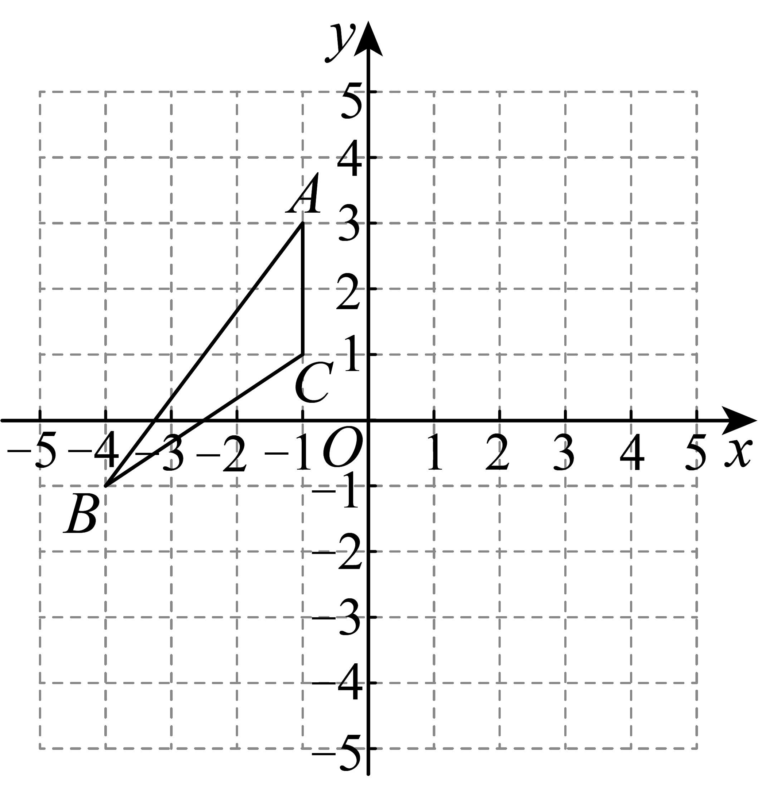
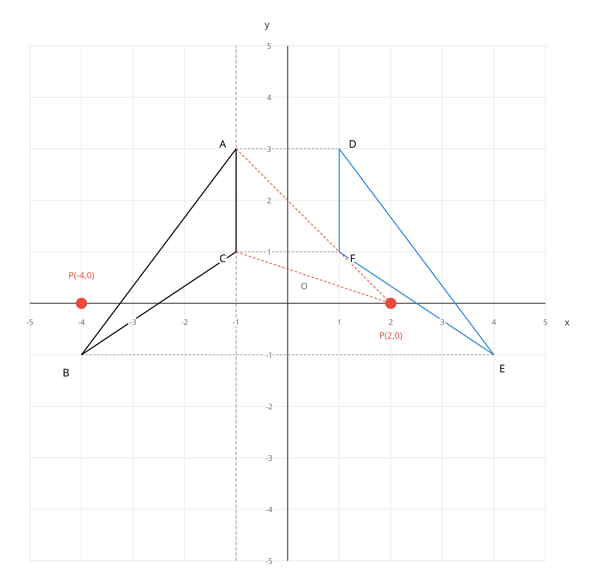

21. （2025八上·海淀期中）在平面直角坐标系 $xOy$ 中，$\triangle ABC$ 的三个顶点坐标分别是 $A(-1,3)$，$B(-4,-1)$，$C(-1,1)$。

（1）请画出 $\triangle ABC$ 关于 $y$ 轴对称的 $\triangle DEF$ （其中 $D$，$E$，$F$ 分别是 $A$，$B$，$C$ 的对应点，不写画法），直接写出点 $E$，$F$ 的坐标：$E$ ___ ，$F$ ___ ；

（2）若点 $P$ 在 $x$ 轴上，且满足 $\triangle ACP$ 与 $\triangle ABC$ 面积相等，则点 $P$ 的坐标为 ___ 。

> [!question]- 点击查看答案与解析
> 【答案】（1）$E(4,-1)$，$F(1,1)$；（2）$(2,0)$ 或 $(-4,0)$
> 
> 【考点】画轴对称的图形 → [[【初中数学知识点体系-人教版】#15-2 画轴对称的图形]]、三角形面积 → [[【初中数学知识点体系-人教版】#13-2 与三角形有关的线段]]
> 
> 【解析】
> （1）如图，关于 $y$ 轴对称，横坐标取相反数、纵坐标不变：$A(-1,3)\to D(1,3)$，$B(-4,-1)\to E(4,-1)$，$C(-1,1)\to F(1,1)$。
> 故 $E(4,-1)$，$F(1,1)$（画图时依次连接 $D$、$E$、$F$ 即得 $\triangle DEF$）。
> （2）$A$、$C$ 的横坐标都是 $-1$，$AC$ 在直线 $x=-1$ 上，$AC=3-1=2$；点 $B$ 到该直线的距离为 $3$，
> $S_{\triangle ABC}=\dfrac{1}{2}\times2\times3=3$。
> 设 $P(p,0)$，则 $P$ 到直线 $x=-1$ 的距离为 $|p+1|$，$S_{\triangle ACP}=\dfrac{1}{2}\times2\times|p+1|=|p+1|$。
> 由 $|p+1|=3$ 得 $p=2$ 或 $p=-4$，故 $P(2,0)$ 或 $P(-4,0)$。
> 
> 
> 
> 【易错点】第（2）问只写一个解（漏掉 $x$ 轴负半轴上的点）；把底边取成 $AB$，或忘记面积公式中的 $\dfrac{1}{2}$。
