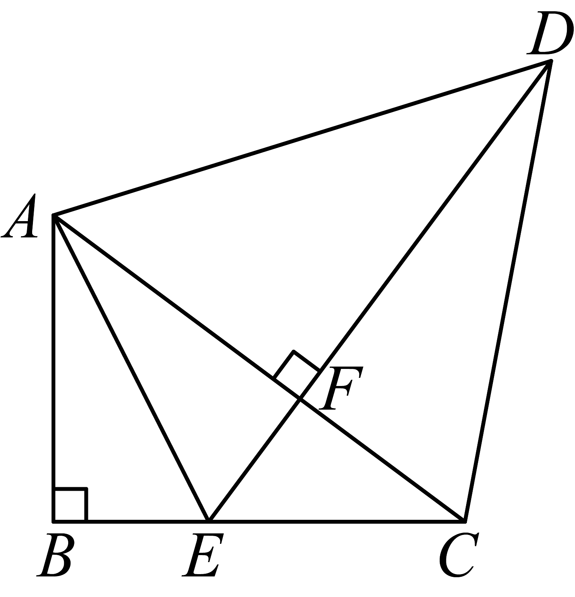

22. （2025八上·海淀期中）已知：如图，四边形 $ABCD$ 中，$AD=AC$，$\angle B=90^{\circ}$，$DE\perp AC$ 于点 $F$，交 $BC$ 于点 $E$，连接 $EA$，$EA$ 平分 $\angle BEF$。

（1）求证：$AB=AF$；

（2）若 $BE=3$，$DF=8$，求 $CE$ 的长。

> [!question]- 点击查看答案与解析
> 【答案】（1）证明见解析（$AAS$）；（2）$CE=\sqrt{73}$
> 
> 【考点】全等三角形的判定 → [[【初中数学知识点体系-人教版】#14-2 三角形全等的判定]]、角平分线 → [[【初中数学知识点体系-人教版】#14-3 角的平分线]]、等腰三角形的判定 → [[【初中数学知识点体系-人教版】#15-3 等腰三角形]]
> 
> 【解析】
> （1）$\because\angle B=90^{\circ}$，$DE\perp AC$ 于 $F$，$\therefore\angle AFE=90^{\circ}=\angle B$；
> $\because EA$ 平分 $\angle BEF$，$\therefore\angle AEB=\angle AEF$；又 $AE=AE$，
> $\therefore\triangle ABE\cong\triangle AFE$（$AAS$），$\therefore AB=AF$。
> （2）由（1）得 $BE=EF=3$，$AB=AF$。
> $\because AD=AC$，且 $AD=AF+FD$，$AC=AF+FC$，$\therefore FD=FC=8$。
> 在 $\mathrm{Rt}\triangle EFC$ 中，$CE=\sqrt{EF^{2}+FC^{2}}=\sqrt{3^{2}+8^{2}}=\sqrt{73}$。
> 
> 【易错点】把 $BE=3$ 当成 $AB=3$；看不出 $AD=AC$ 是“$FD=FC$”的桥梁，转而去求 $AF$ 或 $AB$，越算越乱。
