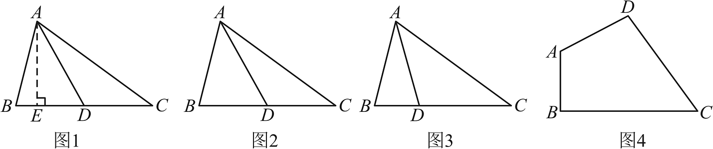
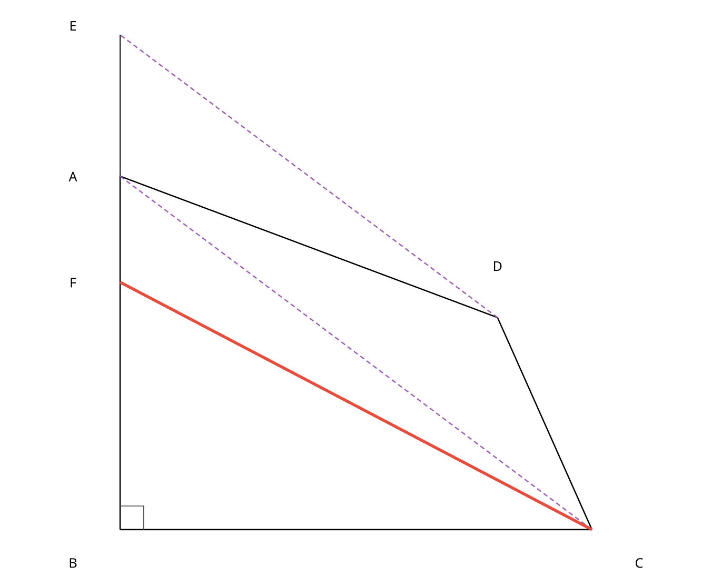

23. （2025八上·海淀期中）数学课上，小明学习了三角形的各种重要线段，他对顶点与对边中点相连的“中线”产生了浓厚的兴趣。经过一番认真的作图与演算，他发现了一个简洁而美妙的结论：三角形的任意一条中线都将三角形分成面积相等的两部分。

已知：如图 1，在 $\triangle ABC$ 中，点 $D$ 是边 $BC$ 的中点，连接 $AD$。

求证：$S_{\triangle ABD}=S_{\triangle ACD}$。

证明：过点 $A$ 作 $AE\perp BC$ 于点 $E$。

$\because$ 点 $D$ 是边 $BC$ 的中点，

$\therefore BD=CD$。

$\because S_{\triangle ABD}=\frac{1}{2}BD\cdot AE$，$S_{\triangle ACD}=\frac{1}{2}CD\cdot AE$，

$\therefore S_{\triangle ABD}=S_{\triangle ACD}$

[探究]

（1）如图 2，在 $\triangle ABC$ 中，点 $D$ 是边 $BC$ 的中点，若 $S_{\triangle ABC}=8$，则 $S_{\triangle ABD}=$ ___ ；

（2）如图 3，在 $\triangle ABC$ 中，点 $D$ 是边 $BC$ 上的点，且 $BC=3BD$，求 $S_{\triangle ABD}:S_{\triangle ACD}$ 的值。

（3）如图 4，现在有一块四边形土地 $ABCD$，甲、乙两人要均分这块土地，请通过画图均分四边形 $ABCD$ 的面积。（要求：用不超过三条的线段画出平分方法，并对画法进行说明，可利用带刻度的直尺）

> [!question]- 点击查看答案与解析
> 【答案】（1）$4$；（2）$1:2$；（3）画法见解析（连 $AC$→过 $D$ 作 $DE\parallel AC$→取 $BE$ 中点 $F$→连 $CF$）
> 
> 【考点】三角形的中线与面积 → [[【初中数学知识点体系-人教版】#13-2 与三角形有关的线段]]、等底等高与面积转化 → [[【初中数学知识点体系-人教版】#13-1 三角形的概念]]
> 
> 【解析】
> （1）$AD$ 是 $BC$ 边上的中线，把 $\triangle ABC$ 分成面积相等的两部分，故 $S_{\triangle ABD}=\dfrac{1}{2}\times8=4$。
> （2）$BC=3BD$，故 $DC=2BD$；$\triangle ABD$ 与 $\triangle ACD$ 同高（都以 $A$ 到 $BC$ 的距离为高），
> 所以 $S_{\triangle ABD}:S_{\triangle ACD}=BD:DC=1:2$。
> （3）如图，画法：$①$ 连接 $AC$；$②$ 过点 $D$ 作 $DE\parallel AC$，交 $BA$ 的延长线于点 $E$；$③$ 取 $BE$ 的中点 $F$，连接 $CF$。则线段 $CF$ 平分四边形 $ABCD$ 的面积（只用 $DE$、$CF$ 两条线段，符合“不超过三条”）。
> 理由：$DE\parallel AC$，$\triangle ACD$ 与 $\triangle ACE$ 同底 $AC$、等高，故 $S_{\triangle ACD}=S_{\triangle ACE}$，于是 $S_{ABCD}=S_{\triangle ABC}+S_{\triangle ACD}=S_{\triangle ABC}+S_{\triangle ACE}=S_{\triangle BCE}$；
> 又 $F$ 是 $BE$ 的中点，$CF$ 是 $\triangle BCE$ 的中线，$S_{\triangle BCF}=\dfrac{1}{2}S_{\triangle BCE}=\dfrac{1}{2}S_{ABCD}$。
> 
> 
> 
> 【易错点】（2）由 $BC=3BD$ 直接写 $1:3$（应是 $BD:DC=1:2$）；（3）不作平行线、随手连一条线段，无法保证面积守恒；只画图不说明理由。
