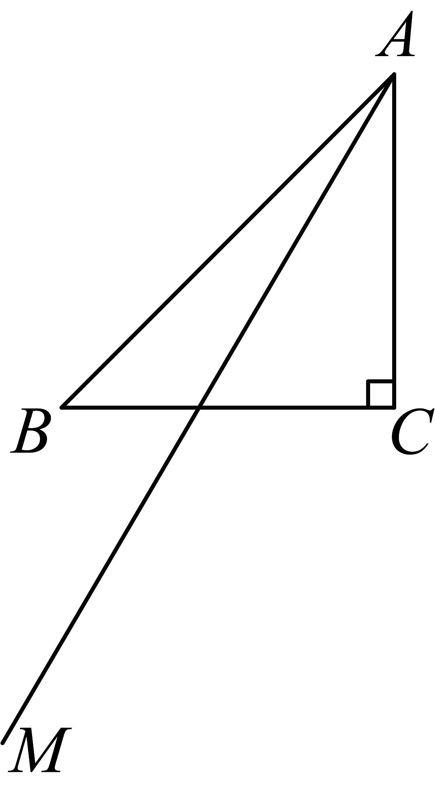
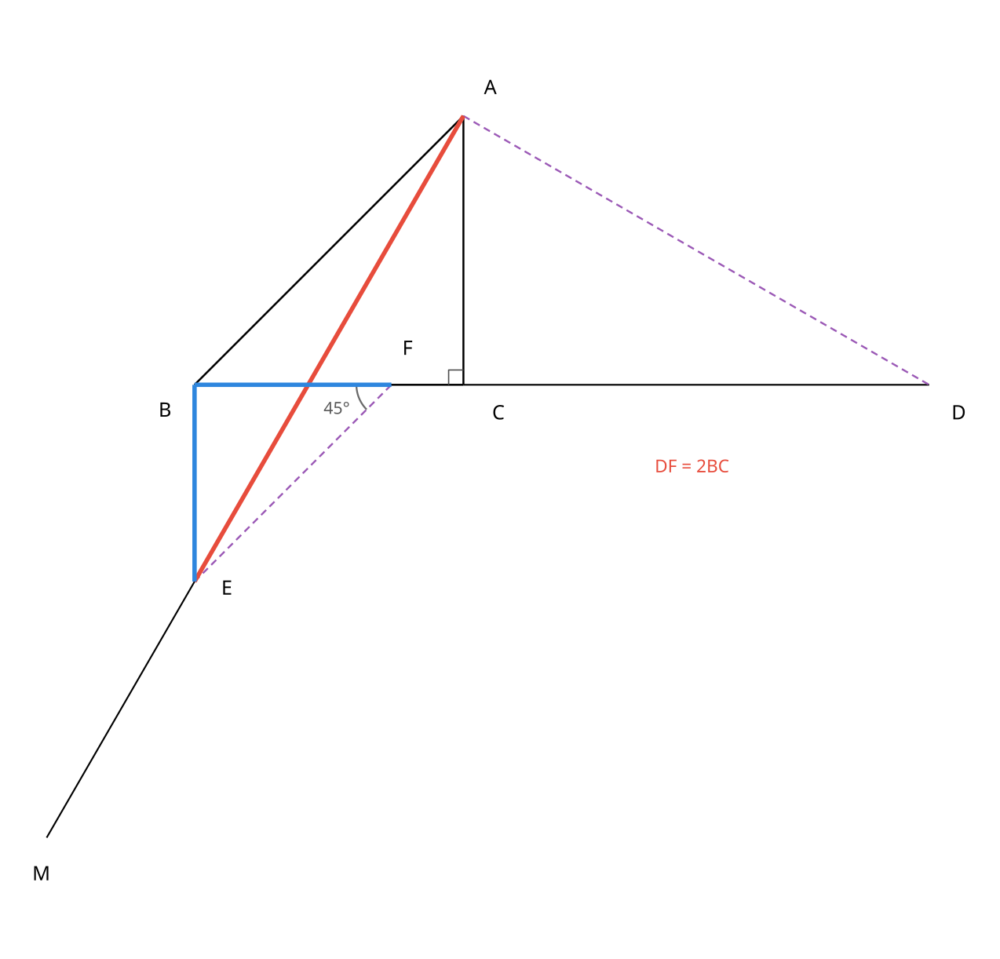

24. （2025八上·海淀期中）如图，$\triangle ABC$ 为等腰直角三角形，$\angle ACB=90^{\circ}$，在 $\angle BAC$ 内作射线 $AM$，过点 $A$ 作 $AM$ 的垂线交线段 $BC$ 的延长线于点 $D$，在射线 $AM$ 上截取 $AE=AD$，连接 $BE$，过点 $E$ 作 $EF\parallel BA$ 交线段 $BC$ 于点 $F$。

（1）依题意补全图形；

（2）求 $\angle BFE$ 的大小；

（3）猜想 $DF$ 与 $BC$ 的数量关系，并证明。

> [!question]- 点击查看答案与解析
> 【答案】（1）补图见解析；（2）$\angle BFE=45^{\circ}$；（3）$DF=2BC$
> 
> 【考点】等腰直角三角形 → [[【初中数学知识点体系-人教版】#15-3 等腰三角形]]、平行线与角 → [[【初中数学知识点体系-人教版】#13-3 三角形的内角与外角]]、全等转化 → [[【初中数学知识点体系-人教版】#14-2 三角形全等的判定]]
> 
> 【解析】
> （1）如图，过 $A$ 作 $AM$ 的垂线交 $BC$ 的延长线于 $D$；在射线 $AM$ 上截 $AE=AD$；连接 $BE$，过 $E$ 作 $EF\parallel BA$ 交 $BC$ 于 $F$。
> （2）$CA=CB$，$\angle ACB=90^{\circ}$，故 $\angle ABC=\angle BAC=45^{\circ}$。
> $EF\parallel BA$，$FB$ 与 $CB$ 在同一直线上，故 $\angle BFE=\angle ABC=45^{\circ}$。
> （3）猜想：$DF=2BC$。证明如下：
> $\because AD\perp AM$，$AE=AD$，$\therefore\triangle ADE$ 是等腰直角三角形，$\angle ADE=\angle AED=45^{\circ}$。
> $\because EF\parallel BA$，$\angle BFE=45^{\circ}$，且 $BE\perp BC$（$AB$ 与 $BC$ 成 $45^{\circ}$、$BE$ 与 $BA$ 成 $45^{\circ}$，合起来为 $90^{\circ}$），$\therefore\mathrm{Rt}\triangle BEF$ 中 $\angle EBF=90^{\circ}-45^{\circ}=45^{\circ}$，$BE=BF$。
> 由 $AC=BC$、$\angle DCA=90^{\circ}$ 与 $\angle ADC=\angle CAD$ 的关系可得 $DC=BC+BE$（即 $BD=BE$），于是 $CF=BC-BF=BC-BE$。
> $\therefore DF=DC+CF=(BC+BE)+(BC-BE)=2BC$。
> （关键一步的通俗说法：$\triangle ABE$ 与 $\triangle ACD$ 可拼成“$BE$ 与 $DC$ 相差一个 $BC$”的关系，再用等腰直角 $\triangle ADE$ 把长度搬到 $F$ 处。）
> 
> 
> 
> 【易错点】只写出 $\angle BFE=\angle ABC$ 却没有说明 $FB$、$EF$ 的对应关系；第（3）问猜成 $DF=BC$ 或 $DF=3BC$，或只写结论不作证明。
