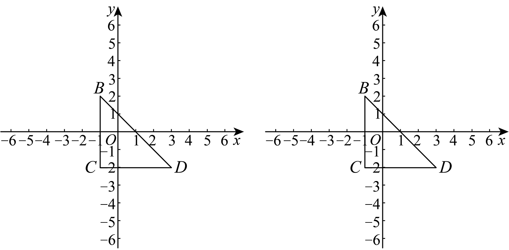

25. （2025八上·海淀期中）在平面直角坐标系 $xOy$ 中，已知点 $P$，直线 $l$ 和图形 $M$，给出如下定义：若图形 $M$ 内部或边上存在一点 $P'$，使 $P$ 和 $P'$ 关于直线 $l$ 轴对称，则称点 $P$ 为图形 $M$ 关于直线 $l$ 的“反射内含点”。已知 $\triangle BCD$ 的三个顶点的坐标分别是 $B(-1,2)$，$C(-1,-2)$，$D(3,-2)$。设点 $T(t,0)$，直线 $l_{1}$ 为过点 $T(t,0)$ 且与 $x$ 轴垂直的直线。

（1）若 $t=3$，在点 $P_{1}(6,-1)$，$P_{2}(5,0)$，$P_{3}(4,1)$ 中，点 ___ 是 $\triangle BCD$ 关于直线 $l_{1}$ 的“反射内含点”；

（2）当 $t\neq0$ 时，若 $y$ 轴上存在 $\triangle BCD$ 关于直线 $l_{1}$ 的“反射内含点”，则 $t$ 的最大值为 ___ ；

（3）已知直线 $l_{2}$ 过点 $T(t,0)$ 且与第二、四象限角平分线平行。

$①$ 若直线 $l_{2}$ 上存在 $\triangle BCD$ 关于直线 $l_{1}$ 的“反射内含点”，直接写出 $t$ 的取值范围为 ___ ；

$②$ 已知点 $N(0,-t)$ 为边长为 1 的正方形 $EFGH$ 的对角线交点，且正方形 $EFGH$ 的边与坐标轴平行。若正方形 $EFGH$ 边上的所有点都是 $\triangle BCD$ 关于直线 $l_{2}$ 的“反射内含点”，直接写出 $t$ 的取值范围为 ___ 。

> [!question]- 点击查看答案与解析
> 【答案】（1）$P_1$，$P_2$；（2）$\dfrac{3}{2}$；（3）$①-3\le t\le 5$，$②-\dfrac{1}{4}\le t\le 0$
> 
> 【考点】关于直线对称的点的坐标 → [[【初中数学知识点体系-人教版】#15-2 画轴对称的图形]]、图形内部与边界的判定 → [[【初中数学知识点体系-人教版】#13-1 三角形的概念]]
> 
> 【解析】
> $t=3$ 时 $l_1$ 为直线 $x=3$，关于它的对称点横坐标满足 $x+x'=6$。
> $P_1(6,-1)\to(0,-1)$；$P_2(5,0)\to(1,0)$；$P_3(4,1)\to(2,1)$。
> $\triangle BCD$ 中 $B(-1,2)$、$C(-1,-2)$、$D(3,-2)$，边界 $BD$ 所在直线为 $y=1-x$，故 $\triangle BCD$ 是 $-1\le x\le 3$ 且 $-2\le y\le 1-x$ 的三角形区域。
> $(0,-1)$ 与 $(1,0)$ 都在其中（$(1,0)$ 恰在边 $BD$ 上），而 $(2,1)$ 中 $y=1>1-2=-1$，在区域外。
> 所以 $P_1$、$P_2$ 是“反射内含点”。
> （2）设 y 轴上的点 $P(0,y)$ 是反射内含点，则它的对称点 $(2t,y)$ 在 $\triangle BCD$ 内或边上，需 $-1\le 2t\le 3$，即 $-\dfrac{1}{2}\le t\le\dfrac{3}{2}$，故 $t$ 的最大值为 $\dfrac{3}{2}$（此时对称点为 $(3,y)$，取 $y=-2$ 即顶点 $D$）。
> （3）$l_2$ 过 $T(t,0)$ 且与第二、四象限角平分线平行，故 $l_2:x+y=t$。
> $①$ 设 $P(x,y)$ 在 $l_2$ 上，关于 $l_1$ 的对称点为 $(2t-x,y)$。把 $x=t-y$ 代入得对称点为 $(t+y,y)$，令 $u=t+y$，则需 $u$ 满足 $-1\le u\le3$、$-2\le u-t\le1-u$ 有解，
> 即 $2u-1\le t\le u+2$ 关于 $u\in[-1,3]$ 可行；$2u-1$ 的最小值为 $-3$，$u+2$ 的最大值为 $5$（且 $2u-1\le u+2$ 即 $u\le3$ 恒成立），故 $-3\le t\le5$。
> $②$ 正方形中心 $N(0,-t)$、边长 1 且边平行于坐标轴，故 $x\in\left[-\dfrac{1}{2},\dfrac{1}{2}\right]$，$y\in\left[-t-\dfrac{1}{2},-t+\dfrac{1}{2}\right]$。
> 关于 $l_2$ 的对称变换为 $(x,y)\to(t-y,\,t-x)$，令 $u=t-y$、$v=t-x$，则 $u\in\left[2t-\dfrac{1}{2},2t+\dfrac{1}{2}\right]$，$v\in\left[t-\dfrac{1}{2},t+\dfrac{1}{2}\right]$。
> 要求所有 $(u,v)$ 都在 $\triangle BCD$ 内或边上：$u\ge-1$ 得 $t\ge-\dfrac{1}{4}$；$v\ge-2$ 得 $t\ge-\dfrac{3}{2}$（较宽）；$v\le1-u$ 的最坏情形为 $u$、$v$ 同时取最大，即 $t+\dfrac{1}{2}\le1-\left(2t+\dfrac{1}{2}\right)$，得 $t\le0$。
> 取交集得 $-\dfrac{1}{4}\le t\le0$。
> 
> 【易错点】把“$P$ 的对称点在图形内”与“图形内某点的对称点是 $P$”搞反，第（2）问会得出 $t=-\dfrac{1}{2}$ 之类的错误；第（3）问只看个别顶点，没有检查“所有点”与“取最坏角点”。
