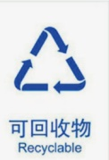
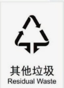
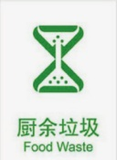
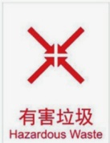

下面图形中，是轴对称图形的是（ ）

$①$

$②$

$③$

$④$

A. $③④$

B. $①②$

C. $①③$

D. $②④$

> [!question]- 点击查看答案与解析
> 【答案】A
> 
> 【考点】轴对称图形的识别 → [[【初中数学知识点体系-人教版】#15-1 图形的轴对称]]
> 
> 【解析】
> - 图形 $①$：不是轴对称图形，找不到对称轴使其折叠后两部分完全重合；
> - 图形 $②$：不是轴对称图形，同样找不到合适的对称轴；
> - 图形 $③$：是轴对称图形，存在一条竖直对称轴；
> - 图形 $④$：是轴对称图形，存在一条对称轴。
> 
> 因此是轴对称图形的是 $③④$，选 A。
> 
> 验证（图标对称性 4 项全部通过）：$①$ 可回收物三箭头循环仅具旋转对称、$②$ 其他垃圾箭头三角无对称轴、$③$ 厨余垃圾有一条竖直对称轴、$④$ 有害垃圾 X 形带十字具轴对称，故轴对称图形为 $③④$，对应选项 A。**修正说明**：原【答案】误写为 C，解析正文对 $③④$ 为轴对称图形的判断正确，属选项字母映射错误，已改为 A。
> 
> 【易错点】判断轴对称图形时，需要找到至少一条对称轴，使图形沿该轴折叠后两部分完全重合。容易将中心对称图形与轴对称图形混淆。
