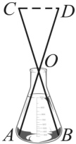

在生物实验课上，老师布置了"测量锥形瓶内部底面内径"的任务。小亮同学想到了以下这个方案：如图，用螺丝钉将两根小棒 $AD$，$BC$ 的中点 $O$ 固定，利用全等三角形的性质，只要测得 $C$，$D$ 之间的距离，就可知道内径 $AB$ 的长度。此方案中，判定 $\triangle AOB$ 和 $\triangle DOC$ 是全等三角形的依据是（ ）

A. SSS

B. SAS

C. ASA

D. AAS

> [!question]- 点击查看答案与解析
> 【答案】B
> 
> 【考点】三角形全等的判定（SAS） → [[【初中数学知识点体系-人教版】#14-2 三角形全等的判定]]
> 
> 【解析】
> - 已知条件：$O$ 是 $AD$ 的中点，$O$ 是 $BC$ 的中点；
> - 因此 $OA = OD$，$OB = OC$；
> - 又 $\angle AOB = \angle DOC$（对顶角相等）；
> - 所以 $\triangle AOB \cong \triangle DOC$（SAS）；
> - 选项 A（SSS）：需要三边对应相等，题目未给出 $AB = DC$，不符合；
> - 选项 C（ASA）：需要两角及其夹边对应相等，题目未给出角的条件，不符合；
> - 选项 D（AAS）：需要两角及一角的对边对应相等，题目未给出角的条件，不符合。
> 
> 【易错点】判断全等三角形时，需要准确识别已知条件中的等量关系，特别是中点提供的边等条件和对顶角提供的角等条件。
