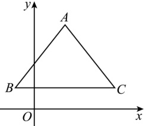

如图，在平面直角坐标系 $xOy$ 中，$\triangle ABC$ 为等腰三角形，$AB=AC$，$BC \parallel x$ 轴，若 $A(2,5)$，$B(-1,1)$，则点 $C$ 的坐标为（ ）

A. $(2,3)$

B. $(3,1)$

C. $(5,1)$

D. $(1,5)$

> [!question]- 点击查看答案与解析
> 【答案】C
> 
> 【考点】平面直角坐标系中点的坐标、等腰三角形的性质 → [[【初中数学知识点体系-人教版】#9-1 用坐标描述平面内点的位置]]
> 
> 【解析】
> - 已知 $BC \parallel x$ 轴，所以 $B$、$C$ 两点的纵坐标相同；
> - $B(-1,1)$，所以 $C$ 的纵坐标为 $1$；
> - 又 $AB = AC$，$\triangle ABC$ 为等腰三角形，$A$ 在 $BC$ 的垂直平分线上；
> - $A(2,5)$，所以 $BC$ 的中点横坐标为 $2$；
> - 设 $C(x,1)$，则 $\frac{-1+x}{2}=2$，解得 $x=5$；
> - 所以 $C(5,1)$；
> - 选项 A：$(2,3)$ 纵坐标不是 $1$，不符合 $BC \parallel x$ 轴；
> - 选项 B：$(3,1)$ 代入验证，$BC$ 中点横坐标为 $\frac{-1+3}{2}=1 \neq 2$，不符合；
> - 选项 D：$(1,5)$ 纵坐标不是 $1$，不符合 $BC \parallel x$ 轴。
> 
> 【易错点】利用等腰三角形的性质时，需要结合 $BC \parallel x$ 轴的条件，得出 $B$、$C$ 纵坐标相同，再利用 $A$ 在 $BC$ 的垂直平分线上求解。
