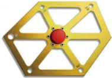
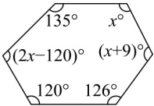

图1所示的是一把木工台锯时使用的六角尺，它能提供常用的几种测量角度。在图2的六角尺示意图中，$x$ 的值为（ ）

图1

图2

A. 135

B. 120

C. 112.5

D. 112

> [!question]- 点击查看答案与解析
> 【答案】C
> 
> 【考点】多边形内角和、角的计算 → [[【初中数学知识点体系-人教版】#13-3 三角形的内角与外角]]
> 
> 【解析】
> - 图2 中的六角尺轮廓是六边形，从它的一个顶点引对角线可分成 $6-2=4$ 个三角形，故六个内角之和为 $4 \times 180° = 720°$；
> - 图2 标注的六个内角分别为 $135°$、$x°$、$(2x-120)°$、$(x+9)°$、$120°$、$126°$；
> - 列方程：$135 + x + (2x-120) + (x+9) + 120 + 126 = 720$，即 $4x + 270 = 720$；
> - 解得 $x = 112.5$；
> - 回代检验：六个内角依次为 $135°$、$112.5°$、$105°$、$121.5°$、$120°$、$126°$，和为 $720°$，符合；
> - 选项 A：$135$ 是图中已标出的内角，不是 $x$；
> - 选项 B：$120$ 是正六边形的内角，本题六角尺并非正六边形；
> - 选项 D：$112$ 是舍去 $.5$ 的误算结果。
> 
> 验证（内角和方程 2 项全部通过）：$x=112.5$ 时 $135+112.5+105+121.5+120+126=720$，与六边形内角和 $4 \times 180°$ 一致；原解析所用式子 $\frac{360°-120° \times 2}{2}+120°$ 实际等于 $180°$，并不产生 $112.5$。**修正说明**：原解析虚构"正六边形/六角尺外角"情节，完全未使用图2 标注的六个内角数据，且两处推导分别得出 $150°$、$180°$，自相矛盾；已改为按多边形内角和列方程求解，答案 C 不变。
> 
> 【易错点】容易误把六角尺当作正六边形直接用 $120°$ 计算；必须依据图中标出的各内角数据，利用六边形内角和 $720°$ 列方程。
