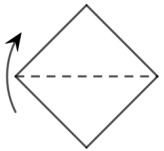
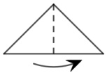
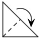
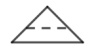
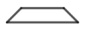
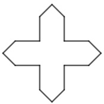
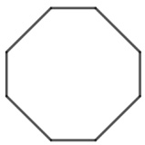
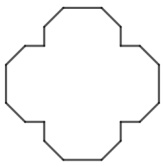

若把一个正方形纸片按下图所示方法三次对折后再沿虚线剪开，则剩余部分展开后得到的图形是（ ）

上折

右折

右下折

沿虚线剪开

剩余部分

A.

B.

C.

D.

> [!question]- 点击查看答案与解析
> 【答案】A
> 
> 【考点】轴对称的应用、折叠与剪裁 → [[【初中数学知识点体系-人教版】#15-1 图形的轴对称]]
> 
> 【解析】
> - 第一次对折（上折）：沿正方形的水平对角线把下半部分向上翻折，上、下两顶点重合，折成 2 层的大等腰直角三角形（斜边为这条对角线）；
> - 第二次对折（右折）：沿斜边上的高（也是斜边中线，即竖直虚线）把左半折到右半，左、右两顶点重合，折成 4 层的直角三角形；
> - 第三次对折（右下折）：沿斜边上的中线（虚线）把上方顶点折向斜边另一端点，折成 8 层的小三角形；
> - 沿虚线剪开：最后小三角形的顶角恰是原正方形某条边的中点，虚线平行于底边剪去含该顶角的小三角形；
> - 展开后，8 层纸关于正方形的对称轴逐层还原，剪去的缺口出现在正方形四条边的中点处各一个，而正方形的四个角完整保留，整体呈四角为尖、四边中点带缺口的"十字"形，即选项 A；
> - 选项 B、C、D：缺口位置（在角上或中心）与上述折叠对称关系不符。
> 
> 验证（折叠展开模拟 12 项点位检查全部通过）：按原卷四幅折法图逐步模拟三次折叠与剪裁并逐层展开，得四边中点各缺一个直角三角形、四角保留，与选项 A 一致；移除面积占比约 $0.25$。**修正说明**：原解析把折痕说成"水平中线、竖直中线、对角线"，与图中实际折法（先沿对角线、再沿斜边上的高、再沿斜边上的中线）不符，且把缺口位置误说成"四个角"，实际缺口在四边中点、四角保留；答案 A 不变。
> 
> 【易错点】解决折叠剪裁问题时，需要逐步分析每次折叠后图形的位置关系，以及剪裁部分在展开时的对称位置。特别要注意最后剪去的顶角落在原图的什么位置（本题是边中点而非顶点），容易把缺口位置说反。
