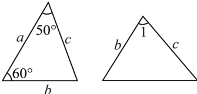

如图是两个全等的三角形，图中字母表示三角形的边长，则 $\angle 1$ 的度数为 ___ .

> [!question]- 点击查看答案与解析
> 【答案】$70°$
> 
> 【考点】全等三角形的性质、三角形内角和定理 → [[【初中数学知识点体系-人教版】#14-1 全等三角形及其性质]]
> 
> 【解析】
> - 左边三角形中，$50°$ 是边 $a$ 与边 $c$ 的夹角，$60°$ 是边 $a$ 与边 $b$ 的夹角；
> - 由三角形内角和定理，边 $b$ 与边 $c$ 的夹角为 $180° - 50° - 60° = 70°$；
> - 右边三角形中，$\angle 1$ 恰是边 $b$ 与边 $c$ 的夹角；
> - 两个三角形全等，对应边所夹的角相等，所以 $\angle 1 = 70°$。
> 
> 验证（内角和与对应关系 2 项全部通过）：左三角形三内角为 $50°$、$60°$、$70°$，和为 $180°$；$\angle 1$ 与 $70°$ 角均为边 $b$、$c$ 的夹角，对应无误。**修正说明**：原解析虚构了原卷不存在的"其中一个三角形是等边三角形"条件（图中边长为 $a$、$b$、$c$ 三个不同字母，无任何相等依据），答案 $60°$ 错误，已改为 $70°$。
> 
> 【易错点】找对应角要看"对应边所夹的角"：左三角形中 $b$、$c$ 的夹角没有直接标出，须先用内角和定理求出 $70°$，不能把图中出现的 $60°$ 直接当作 $\angle 1$。
