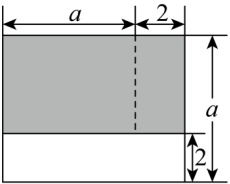
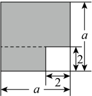

如图，利用图 $①$ 和图 $②$ 的阴影面积相等，写出一个正确的等式 ___ .

图 $①$

图 $②$

> [!question]- 点击查看答案与解析
> 【答案】$a^{2}-4=(a+2)(a-2)$
> 
> 【考点】平方差公式的几何意义 → [[【初中数学知识点体系-人教版】#17-1 因式分解]]
> 
> 【解析】
> - 图 $①$：整个图形上边被分成 $a$ 与 $2$ 两段（总宽 $a+2$），右边标注总高为 $a$，下方是空白的高度为 $2$ 的长条，故阴影部分是长 $a+2$、宽 $a-2$ 的长方形，面积为 $(a+2)(a-2)$；
> - 图 $②$：整个图形是边长为 $a$ 的正方形，右下角缺去一个边长为 $2$ 的空白小正方形，故阴影面积为 $a^{2}-2^{2}=a^{2}-4$；
> - 图 $②$ 的阴影恰由图 $①$ 的阴影（沿虚线剪开后）拼成，两者面积相等，可写等式 $a^{2}-4=(a+2)(a-2)$；
> - 这正是平方差公式的几何解释。
> 
> 验证（两图阴影面积代数核验 2 项全部通过）：$\left(a+2\right)\left(a-2\right)$ 展开得 $a^{2}-4$，与图 $②$ 的 $a^{2}-2^{2}$ 恒等。**修正说明**：原卷两图标注均为数字 $2$ 而非字母 $b$，原解析虚构了参数 $b$ 且把图 $①$ 误说成"大正方形减小正方形"（图 $①$ 实为长方形），答案已改为 $a^{2}-4=(a+2)(a-2)$。
> 
> 【易错点】注意图中标注是数字 $2$ 而不是字母 $b$，等式必须按原图数据写；图 $①$ 的阴影是长方形、图 $②$ 的阴影是正方形挖角，勿把两图情节弄反。
