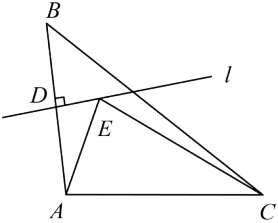

如图，在 $\triangle ABC$ 中，点 $D$ 是 $AB$ 边的中点，过点 $D$ 作边 $AB$ 的垂线 $l$，$E$ 是 $l$ 上任意一点，且 $AC=5$，$BC=8$，则 $\triangle AEC$ 的周长最小值为 ___ 。

> [!question]- 点击查看答案与解析
> 【答案】$13$
> 
> 【考点】线段垂直平分线的性质、轴对称求最短路径 → [[【初中数学知识点体系-人教版】#15-2 画轴对称的图形]]
> 
> 【解析】
> - $l$ 是 $AB$ 的垂直平分线，$E$ 在 $l$ 上，所以 $EA = EB$；
> - $\triangle AEC$ 的周长 $= AE + EC + AC = BE + EC + AC$；
> - 要使周长最小，即求 $BE + EC$ 的最小值；
> - 当 $B$、$E$、$C$ 三点共线时，$BE + EC$ 最小，最小值为 $BC$；
> - 所以 $\triangle AEC$ 的周长最小值 $= BC + AC = 8 + 5 = 13$。
> 
> 【易错点】利用垂直平分线的性质将 $AE$ 转化为 $BE$，再利用三点共线求最短路径。容易忽略利用轴对称转化线段。
