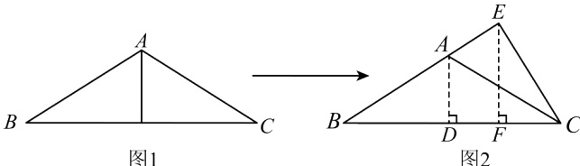

如图1，某温室屋顶结构外框为 $\triangle ABC$，其中 $\angle B=\angle C=30^{\circ}$，立柱 $AD=2$ m，且与横梁 $BC$ 垂直。冬季将至，为了增大向阳面积，将立柱增高并改变位置，使屋顶结构外框变为 $\triangle EBC$（点 $E$ 在 $BA$ 的延长线上），立柱 $EF \perp BC$，如图2所示。若此时立柱 $EF=3$ m，则向阳面斜梁增加部分 $AE$ 的长度为 ___ m。

> [!question]- 点击查看答案与解析
> 【答案】$2$
> 
> 【考点】等腰三角形的性质、含 $30°$ 角的直角三角形 → [[【初中数学知识点体系-人教版】#15-3 等腰三角形]]
> 
> 【解析】
> - 在 $\triangle ABC$ 中，$\angle B = \angle C = 30°$，$AD \perp BC$，$AD = 2$ m；
> - 在 Rt$\triangle ABD$ 中，$\angle B = 30°$，所以 $AB = 2AD = 2 \times 2 = 4$ m；
> - 同理 $AC = 4$ m；
> - 在 $\triangle EBC$ 中，$EF \perp BC$，$EF = 3$ m；
> - 在 Rt$\triangle BEF$ 中，$\angle B = 30°$，所以 $BE = 2EF = 2 \times 3 = 6$ m；
> - $AE = BE - AB = 6 - 4 = 2$ m。
> 
> 【易错点】在含 $30°$ 角的直角三角形中，$30°$ 角所对的直角边等于斜边的一半。容易混淆边与角的对应关系。
