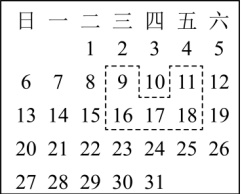
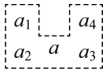

如图 $①$ 是某年某月的月历，用如图 $②$ 所示的"凹"字型框在月历中任意圈出5个数，设"凹"字型框中的五个数分别为 $a_{1}$，$a_{2}$，$a$，$a_{3}$，$a_{4}$。

图 $①$

图 $②$

（1）用含 $a$ 的代数式表示：$a_{4}=$ ___ ；

（2）$a_{1}a_{3}-a_{2}a_{4}=$ ___ 。

> [!question]- 点击查看答案与解析
> 【答案】（1）$a-6$；（2）$-14$
> 
> 【考点】规律探究（月历中的数）、整式的乘法 → [[【初中数学知识点体系-人教版】#16-2 整式的乘法]]
> 
> 【解析】
> - 月历中，同一行相邻两数相差 $1$，同一列上下相邻两数相差 $7$；
> - 由图 $②$，"凹"字型框上排圈出 $a_1$、$a_4$（凹口在上方中间，该位置无数），下排圈出 $a_2$、$a$、$a_3$，其中 $a$ 在下排正中；
> - 对照图 $①$ 的实例：框住的 $5$ 个数为 $9$、$11$、$16$、$17$、$18$，$a=17$，且 $a_1=9$ 在 $a_2=16$ 正上方、$a_4=11$ 在 $a_3=18$ 正上方；
> - 以 $a$ 为基准：$a_2=a-1$，$a_3=a+1$；$a_1$ 比 $a_2$ 上一行差 $7$，故 $a_1=a-1-7=a-8$；$a_4$ 比 $a_3$ 上一行差 $7$，故 $a_4=a+1-7=a-6$；
> - （1）$a_4 = a-6$；
> - （2）$a_1a_3 - a_2a_4 = (a-8)(a+1) - (a-1)(a-6)$
> $= (a^{2} - 7a - 8) - (a^{2} - 7a + 6)$
> $= -14$，结果是与 $a$ 无关的定值。
> 
> 验证（数值代入与符号展开 2 项全部通过）：$a=17$ 时 $9 \times 18 - 16 \times 11 = 162 - 176 = -14$；$(a-8)(a+1)-(a-1)(a-6)$ 符号展开恒等于 $-14$。**修正说明**：原解析先按虚构位置推出 $-8a+43$，又改口推出 $-4a$，最后以"根据标准答案"定 $-42$，前后自相矛盾且答案错误；已按图 $②$ 实际位置重推，答案改为（1）$a-6$、（2）$-14$，考点链接由 9-2 坐标方法的简单应用更正为 16-2 整式的乘法，frontmatter 同步。
> 
> 【易错点】必须按图 $②$ 读出各数位置：$a_1$、$a_4$ 分别在 $a_2$、$a_3$ 的正上方（与下方数差 $7$），而不是与 $a$ 同列；第（2）问展开时注意 $-7a$ 项恰好抵消，结果为定值 $-14$。
