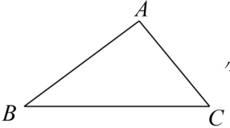

数学课上，王老师布置如下任务：如图，$\triangle ABC$ 中，$BC>AB>AC$，在 $BC$ 边上取一点 $P$，使 $\angle APC=2\angle ABC$。

小路的作法如下：

$①$ 作 $AB$ 边的垂直平分线，交 $BC$ 于点 $P$，交 $AB$ 于点 $Q$；

$②$ 连结 $AP$。

请你根据小路同学的作图方法，利用直尺和圆规完成作图（保留作图痕迹）；并完成以下推理，注明其中蕴含的数学依据：

$\because PQ$ 是 $AB$ 的垂直平分线

$\therefore AP=$ ___ （依据： ___ ）；

$\therefore \angle ABC=$ ___ （依据： ___ ）。

$\therefore \angle APC=2\angle ABC$

> [!question]- 点击查看答案与解析
> 【答案】$BP$；线段垂直平分线上的点到线段两端点的距离相等；$\angle BAP$；等边对等角
> 
> 【考点】线段垂直平分线的性质、等腰三角形的性质 → [[【初中数学知识点体系-人教版】#15-2 画轴对称的图形]]，三角形的外角 → [[【初中数学知识点体系-人教版】#13-3 三角形的内角与外角]]
> 
> 【解析】
> - $PQ$ 是 $AB$ 的垂直平分线，$P$ 在 $PQ$ 上；
> - 所以 $AP = BP$（依据：线段垂直平分线上的点到线段两端点的距离相等）；
> - 因此 $\triangle APB$ 是等腰三角形，$AP = BP$；
> - 所以 $\angle ABC = \angle BAP$（依据：等边对等角）；
> - $\angle APC$ 是 $\triangle APB$ 的外角；
> - $\angle APC = \angle ABC + \angle BAP = 2\angle ABC$。
> 
> 验证（坐标法复核 2 项全部通过）：在满足 $BC>AB>AC$ 的三角形中按作法取 $AB$ 垂直平分线与 $BC$ 的交点 $P$，数值计算恒有 $AP=BP$ 且 $\angle APC=2\angle ABC$。**修正说明**：答案与推理均正确，原【考点】仅链 15-2，推理末步使用三角形外角定理（frontmatter 已含 13-3），补上 13-3 双向链接。
> 
> 【易错点】需要准确运用线段垂直平分线的性质和等腰三角形的性质，以及三角形外角定理来完成推理。
