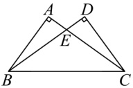

如图，$A, D$ 两点在 $BC$ 所在直线同侧，$AB \perp AC, BD \perp CD$，垂足分别为 $A, D, AC, BD$ 的交点为 $E, AB=DC$。求证：$BE=CE$。

> [!question]- 点击查看答案与解析
> 【答案】证明见解析
> 
> 【考点】三角形全等的判定与性质 → [[【初中数学知识点体系-人教版】#14-2 三角形全等的判定]]
> 
> 【解析】
> - 已知 $AB \perp AC$，$BD \perp CD$，所以 $\angle BAC = \angle BDC = 90°$；
> - 在 $\triangle ABE$ 和 $\triangle DCE$ 中：
>   - $\angle AEB = \angle DEC$（对顶角相等）
>   - $\angle BAE = \angle CDE = 90°$
>   - $AB = DC$（已知）
> - 所以 $\triangle ABE \cong \triangle DCE$（AAS）；
> - 因此 $BE = CE$（全等三角形对应边相等）。
> 
> 【易错点】证明全等三角形时，需要准确找出对应相等的角和边。本题利用了对顶角相等和已知的垂直关系。
