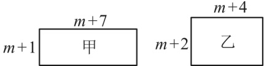

如图，甲长方形的两边长分别为 $m+1$，$m+7$，面积为 $S_{1}$，乙长方形的两边长分别为 $m+2$，$m+4$，面积为 $S_{2}$（其中 $m$ 为正整数）。

（1）$S_{1}=$ ___ ，$S_{2}=$ ___ （用含 $m$ 的多项式表示），$S_{1}$ ___ $S_{2}$（填"$<$"、"$=$"或"$>$"）；

（2）有一正方形，其周长与甲长方形周长相等，面积为 $S$，求证：$S-S_{1}$ 为定值。

> [!question]- 点击查看答案与解析
> 【答案】（1）$S_1 = m^2+8m+7$，$S_2 = m^2+6m+8$，$S_1 > S_2$；（2）证明见解析
> 
> 【考点】多项式乘多项式 → [[【初中数学知识点体系-人教版】#16-2 整式的乘法]]，乘法公式、完全平方公式 → [[【初中数学知识点体系-人教版】#16-3 乘法公式]]
> 
> 【解析】
> （1）$S_1 = (m+1)(m+7) = m^2 + 7m + m + 7 = m^2 + 8m + 7$
> 
> $S_2 = (m+2)(m+4) = m^2 + 4m + 2m + 8 = m^2 + 6m + 8$
> 
> $S_1 - S_2 = (m^2+8m+7) - (m^2+6m+8) = 2m - 1$
> 
> 因为 $m$ 为正整数，$m \geq 1$，所以 $2m - 1 \geq 1 > 0$，即 $S_1 > S_2$。
> 
> （2）甲长方形周长 $= 2[(m+1)+(m+7)] = 2(2m+8) = 4m+16$
> 
> 正方形周长 $= 4m+16$，边长 $= m+4$
> 
> $S = (m+4)^2 = m^2 + 8m + 16$
> 
> $S - S_1 = (m^2+8m+16) - (m^2+8m+7) = 9$
> 
> 所以 $S - S_1 = 9$，为定值。
> 
> 验证（两问数值核验 3 项全部通过）：$m=1$ 时 $S_1=16 > S_2=15$；一般地 $S_1-S_2=2m-1 \geq 1 > 0$，故 $S_1 > S_2$；（2）中正方形边长 $m+4$，$S-S_1=9$ 与 $m$ 无关。**修正说明**：解析推导与 $m=1$ 验算均正确得到 $S_1 > S_2$，但【答案】（1）误写为 $S_1 < S_2$，已改正；原"重新计算"段并入验证段；第（1）问展开属多项式乘多项式，【考点】补上 16-2 整式的乘法链接。
> 
> 【易错点】（1）多项式乘法需要展开后合并同类项再比较大小，作差 $2m-1$ 的符号由 $m$ 为正整数决定，勿误判为 $S_1 < S_2$；（2）证明定值问题需要先求出表达式，再化简验证结果与变量无关。
