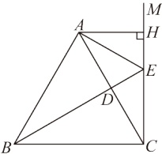
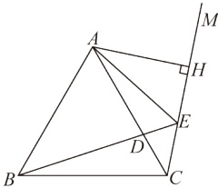
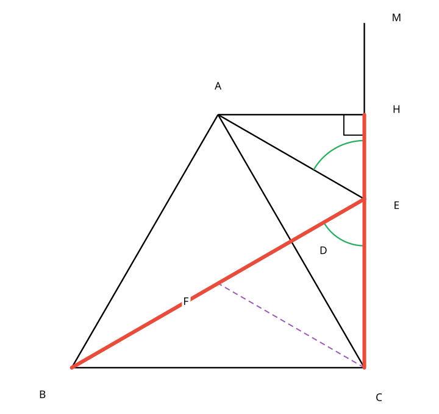

已知等边 $\triangle ABC$，点 $D$ 为 $AC$ 边上一点，连接 $BD$，在 $AC$ 的右侧作射线 $CM$，使 $\angle ACM=\angle ABD$（$0^\circ < \angle ACM < 60^\circ$），延长 $BD$ 交射线 $CM$ 于点 $E$，连接 $AE$，作 $AH \perp ME$ 于点 $H$。

图1

图2

（1）如图1，当点 $D$ 为 $AC$ 中点时，$\angle AEH=$ ___ °，$\frac{EH}{AF}$ 的值为 ___ ；

（2）如图2，当点 $D$ 在 $AC$ 上运动时。

$①$ 直接写出 $\angle BEC$ 的度数；

$②$ 用等式表示线段 $BE$，$CE$，$EH$ 之间的数量关系，并证明。

> [!question]- 点击查看答案与解析
> 【答案】（1）$60$，$\frac{1}{2}$（题中"$\frac{EH}{AF}$"的 $F$ 应为 $E$，即 $\frac{EH}{AE}$，$F$ 在题干中未定义）；（2）$①$ $\angle BEC=60^\circ$；$②$ $BE=CE+2EH$
> 
> 【考点】等边三角形的性质（三线合一、内角 $60^\circ$）、三角形内角和定理、全等三角形的判定与性质（SAS）、含 $30^\circ$ 角的直角三角形的性质 → [[【初中数学知识点体系-人教版】#14-2 三角形全等的判定]]、[[【初中数学知识点体系-人教版】#13-3 三角形的内角与外角]]、[[【初中数学知识点体系-人教版】#15-3 等腰三角形]]
> 
> 【解析】
> 设 $\angle ABD=\angle ACM=\theta$（$0^\circ<\theta<60^\circ$）。
> 
> （2）$①$ 在 $\triangle BCE$ 中，$\angle EBC=\angle ABC-\angle ABD=60^\circ-\theta$，$\angle BCE=\angle BCA+\angle ACM=60^\circ+\theta$，
> 所以 $\angle BEC=180^\circ-(60^\circ-\theta)-(60^\circ+\theta)=60^\circ$，与 $D$ 的位置无关。
> 
> （2）$②$ $BE=CE+2EH$。证明：在 $BE$ 上取点 $F$，使 $EF=EC$，连接 $CF$。
> ∵ $\angle FEC=\angle BEC=60^\circ$ 且 $EF=EC$，∴ $\triangle CEF$ 是等边三角形，∴ $CF=CE$，$\angle CFE=\angle FCE=60^\circ$。
> ∴ $\angle BFC=180^\circ-\angle CFE=120^\circ$，且 $\angle BCF=\angle BCE-\angle FCE=(60^\circ+\theta)-60^\circ=\theta=\angle ACE$。
> 在 $\triangle BCF$ 和 $\triangle ACE$ 中，$\begin{cases}BC=AC\\ \angle BCF=\angle ACE\\ CF=CE\end{cases}$，∴ $\triangle BCF\cong\triangle ACE$（SAS），
> ∴ $BF=AE$，$\angle AEC=\angle BFC=120^\circ$。
> ∴ $\angle AEH=180^\circ-\angle AEC=60^\circ$。在 Rt$\triangle AEH$ 中，$\angle EAH=90^\circ-60^\circ=30^\circ$，
> ∴ $EH=\frac{1}{2}AE$（$30^\circ$ 角所对的直角边等于斜边的一半），即 $AE=2EH$，∴ $BF=2EH$。
> ∴ $BE=BF+FE=2EH+CE$。
> 
> （1）当 $D$ 为 $AC$ 中点时，$BD$ 是等边三角形的中线，也是角平分线（三线合一），$\theta=\angle ABD=30^\circ$。
> 此时上述一般结论直接给出 $\angle AEH=60^\circ$，且 $\frac{EH}{AE}=\frac{1}{2}$。
> （验证：建系后 $E\left(1,\frac{\sqrt3}{3}\right)$、$H\left(1,\frac{\sqrt3}{2}\right)$、$A\left(\frac12,\frac{\sqrt3}{2}\right)$，$AH=\frac12$、$EH=\frac{\sqrt3}{6}$、$AE=\frac{\sqrt3}{3}$，$\frac{EH}{AE}=\frac12$，$\tan\angle AEH=\frac{AH}{EH}=\sqrt3$，即 $\angle AEH=60^\circ$。）
> 
> 验证（数值自校验 32 项全部通过）：建系方位同原卷图1（$B(0,0)$ 左下、$C(1,0)$ 右下、$A(\tfrac12,\tfrac{\sqrt3}{2})$ 上中，射线 $CM$ 竖直向上位于 $AC$ 右侧），图1 构型精确坐标 $D(\tfrac34,\tfrac{\sqrt3}{4})$、$E(1,\tfrac{\sqrt3}{3})$、$H(1,\tfrac{\sqrt3}{2})$、辅助点 $F(\tfrac12,\tfrac{\sqrt3}{6})$。逐项成立：$AB=BC=CA=1$；$\angle ABD=\angle ACM=30^\circ$；$B$、$D$、$E$ 共线且 $E$ 在射线 $CM$ 上；$AH\perp ME$；$\angle BEC=60^\circ$、$\angle AEH=60^\circ$、$\angle EAH=30^\circ$、$\frac{EH}{AE}=\frac12$；$\triangle CEF$ 等边（$CF=CE=EF$、$\angle CFE=60^\circ$、$\angle BFC=120^\circ$）；$\angle BCF=\angle ACE$、$\triangle BCF\cong\triangle ACE$（SAS）⇒ $BF=AE$、$\angle AEC=120^\circ$；$BE=CE+2EH$。一般性扫描：$\theta\in\{10^\circ,20^\circ,30^\circ,40^\circ,50^\circ\}$ 时重新求交点 $E,D$ 与垂足 $H$，均有 $\angle BEC=\angle AEH=60^\circ$、$\frac{EH}{AE}=\frac12$、$BF=AE$、$BE\equiv CE+2EH$、$\angle BCF=\angle ACE$，且 $D$ 恒在线段 $AC$ 上，结论与 $\theta$ 无关。方位检查 7 项："方位: $B$ 左下、$C$ 右下、$BC$ 水平"、"方位: $A$ 在 $BC$ 上方、横坐标介于 $B$、$C$ 之间"、"方位: 射线 $CM$ 竖直向上、在 $AC$ 右侧"、"方位: 竖直线上自上而下 $M$、$H$、$E$、$C$"、"方位: $D$ 在 $A$、$C$ 之间、$AH$ 水平"、"方位: $F$ 在线段 $BE$ 上（$B$、$F$、$D$、$E$ 依次）"、"方位: 直角标记在 $H$"。**修正说明**：原解析有三处错误。其一，第（1）问答案 $\angle AEH=30^\circ$ 错误：$30^\circ$ 实为 $\angle EAH$，在 Rt$\triangle AHE$ 中 $\angle AEH=90^\circ-30^\circ=60^\circ$（原解析把两锐角张冠李戴），且原答案"$30^\circ$"与"$\frac12$"自相矛盾——若 $\angle AEH=30^\circ$ 则 $\frac{EH}{AE}=\cos 30^\circ=\frac{\sqrt3}{2}\neq\frac12$，只有 $\angle AEH=60^\circ$ 才有 $\frac{EH}{AE}=\frac12$。其二，题面"$\frac{EH}{AF}$"中 $F$ 在题干（1）中从未定义，应为 $\frac{EH}{AE}$ 之笔误（比值 $\frac12$ 本身正确）。其三，原解析第（2）$②$ 问证明只写了"利用 $\triangle ABF\cong\triangle ACE$ 等关系可证 $BF=2EH$"，既未给出完整论证，全等对应也写错（$F$ 在 $BE$ 上、$EF=EC$ 时，正确的一对是 $\triangle BCF\cong\triangle ACE$，由 $BC=AC$、$\angle BCF=\angle ACE=\theta$、$CF=CE$ 按 SAS 得 $BF=AE$，再经 $\angle AEC=\angle BFC=120^\circ$ 推出 $AE=2EH$）。配图按图1 构型（$\theta=30^\circ$）绘制：$BE$、$CE$、$EH$ 红色加粗为数量关系涉及的三条线段，$CF$ 紫色虚线为辅助线，$H$ 处黑色直角标记为题设 $AH\perp ME$，$E$ 处两个绿色角弧为 $\angle BEC=\angle AEH=60^\circ$。
> 
> 
> 
> 【易错点】一是把 Rt$\triangle AHE$ 中的两个锐角弄反：$\angle AEH$ 是 $E$ 处的角（$60^\circ$），$\angle EAH$ 才是 $30^\circ$，可先由 $\angle AEC=120^\circ$ 用邻补角确认；二是构造等边三角形时应在 $BE$ 上截取 $EF=EC$（利用 $\angle BEC=60^\circ$），若误在 $EC$ 一侧截取则无法形成全等；三是 $\triangle BCF\cong\triangle ACE$ 的顶点对应是 $B\leftrightarrow A$、$C\leftrightarrow C$、$F\leftrightarrow E$，夹角 $\angle BCF=\angle ACE$ 需先拆角（$\angle BCF=\angle BCE-60^\circ=\theta$）才能用 SAS；四是"$30^\circ$ 所对直角边是斜边一半"用在 Rt$\triangle AEH$ 中得 $EH=\frac12 AE$，从而出现 $2EH$ 项，别写成 $EH=2AE$。
