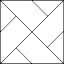
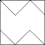
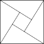
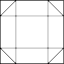

2. （25-26八年级上·北京西城·期末）传统建筑中的窗格样式丰富，体现了我国建筑独特的艺术表现力和文化内涵．小红设计了下列窗格图案，其中可以看成轴对称图形的是（ ）

A. 

B. 

C. 

D. 

> [!question]- 点击查看答案与解析
> 【答案】D
> 
> 【考点】轴对称图形的识别 → [[【初中数学知识点体系-人教版】#15-1 图形的轴对称]]
> 
> 【解析】
> 判断依据：如果一个图形沿一条直线折叠，直线两旁的部分能够互相重合，这个图形就是轴对称图形。
> - 选项A、B、C：内部线条分布找不到一条直线，使沿该直线折叠后两旁完全重合，不是轴对称图形；
> - 选项D：窗格整体关于经过中心的竖直（水平）直线对称，折叠后两旁重合，是轴对称图形。
> 综上，选 D。
> 
> 【易错点】把旋转后能与自身重合的图形误判为轴对称图形；只看外框而忽略内部窗格线条是否对称。
