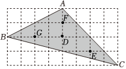

5. （25-26八年级上·北京西城·期末）如图，将一块透明的三角形匀质薄板（记作$\triangle ABC$）放入正方形网格中，其三个顶点都在网格线的交点上，在点$D, E, F, G$（都在网格线的交点上）中，该三角形薄板的重心是（ ）

A. 点$D$

B. 点$E$

C. 点$F$

D. 点$G$

> [!question]- 点击查看答案与解析
> 【答案】A（点 $D$）
> 
> 【考点】三角形重心的概念（三条中线的交点） → [[【初中数学知识点体系-人教版】#13-2 与三角形有关的线段]]
> 
> 【解析】
> 重心是三角形三条中线的交点。在正方形网格中分别作出 $\triangle ABC$ 三边的中线，三条中线交于点 $D$，故该三角形薄板的重心是点 $D$。
> 
> 【易错点】把重心与垂心（三条高的交点）、内心（角平分线交点）混淆；误认为重心是面积平分点或中线上的任意一点。
