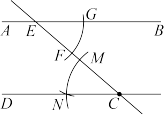

6. （25-26八年级上·北京西城·期末）如图是“过直线$AB$外一点$C$作$AB$的平行线$CD$”的尺规作图．根据该作图方法，可以证明$CD\parallel AB$，证明过程中判定$\triangle CMN\cong\triangle EFG$的依据是（ ）

A. 两角和它们的夹边分别相等的两个三角形全等

B. 两角分别相等且其中一组等角的对边相等的两个三角形全等

C. 两边和它们的夹角分别相等的两个三角形全等

D. 三边分别相等的两个三角形全等

> [!question]- 点击查看答案与解析
> 【答案】D
> 
> 【考点】三角形全等的判定（尺规作一个角等于已知角） → [[【初中数学知识点体系-人教版】#14-2 三角形全等的判定]]
> 
> 【解析】
> 由尺规作图痕迹可知：$EF=EG=CM=CN$，$MN=FG$，即 $\triangle CMN$ 与 $\triangle EFG$ 的三边分别对应相等，依据“三边分别相等的两个三角形全等”（SSS）判定 $\triangle CMN\cong\triangle EFG$，再由对应角相等得到同位角相等，从而 $CD\parallel AB$。
> 
> 【易错点】混淆 SSS、SAS、ASA、AAS 的条件；把作图圆弧保证的等长线段误判为夹角相等，误选 SAS。
