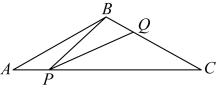
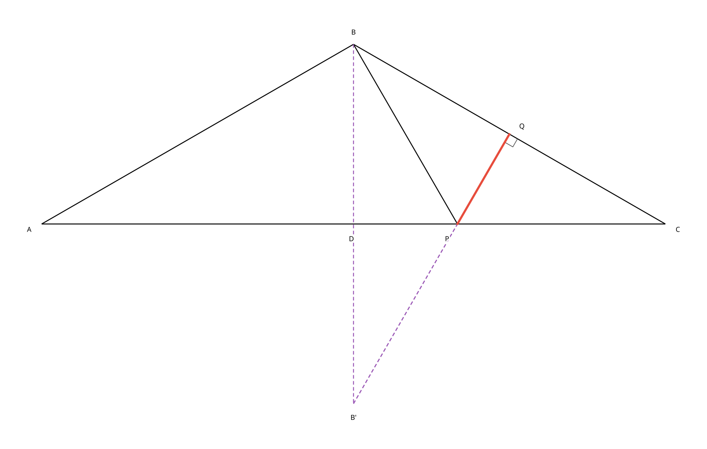

8. （25-26八年级上·北京西城·期末）如图，在$\triangle ABC$中，$BA=BC$，$\angle ABC=120^{\circ}$，$P, Q$分别是边$AC, BC$上的两个动点，连接$BP, PQ$．若当$BP$与$PQ$的和最小时，$PQ$的长为 1，则$AC$的长为（ ）

A. 3

B. 4

C. 6

D. 8

> [!question]- 点击查看答案与解析
> 【答案】C
> 
> 【考点】轴对称求最短路径 → [[【初中数学知识点体系-人教版】#15-1 图形的轴对称]]、等腰三角形三线合一、含 $30^{\circ}$ 角的直角三角形 → [[【初中数学知识点体系-人教版】#15-3 等腰三角形]]
> 
> 【解析】
> 作点 $B$ 关于直线 $AC$ 的对称点 $B'$，交 $AC$ 于点 $D$；过点 $B'$ 作 $B'Q\perp BC$ 于点 $Q$，交 $AC$ 于点 $P$，连接 $BP$。由对称性 $BP=B'P$，于是 $BP+PQ=B'P+PQ=B'Q$，此时 $BP$ 与 $PQ$ 的和最小。
> 在 $\triangle ABC$ 中，$BA=BC$，$\angle ABC=120^{\circ}$，故 $\angle A=\angle C=30^{\circ}$，由三线合一得 $AD=CD$，$\angle ABD=\angle CBD=60^{\circ}$。
> 在 $\mathrm{Rt}\triangle PQC$ 中，$\angle C=30^{\circ}$，$PQ=1$，故 $PC=2PQ=2$。
> 由 $\angle B'DP=\angle PQC=90^{\circ}$，$\angle DPB'=\angle CPQ$，得 $\angle B'=\angle C=30^{\circ}$，于是 $\angle B'=\angle DBP=30^{\circ}$，$\angle PBC=30^{\circ}$，$BP=PC=2$；在 $\mathrm{Rt}\triangle BDP$ 中，$\angle DBP=30^{\circ}$，故 $DP=\frac{1}{2}BP=1$，$DC=DP+PC=3$，$AC=2CD=6$。
> 综上，选 C。
> 
> 
> 【易错点】对称后线段转化（$BP=B'P$）容易漏掉；$30^{\circ}$ 角所对直角边等于斜边一半的对应边用反；最短路径下点 $P$、$Q$ 的位置对应关系判断不清。
