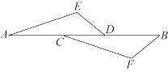

12. （25-26八年级上·北京西城·期末）如图，点$C, D$在线段$AB$上，$\angle EAD=\angle FCB$，$AE=CF$．只需添加一个条件即可证明$\triangle EAD\cong\triangle FCB$，这个条件可以是 ___ （写出一个即可）．

> [!question]- 点击查看答案与解析
> 【答案】$AD=CB$（或 $\angle ADE=\angle CBF$，或 $\angle AED=\angle CFB$，答案不唯一）
> 
> 【考点】三角形全等判定的开放条件补充 → [[【初中数学知识点体系-人教版】#14-2 三角形全等的判定]]
> 
> 【解析】
> 已知 $\angle EAD=\angle FCB$，$AE=CF$，已有一组边、一组角对应相等。
> - 添加 $AD=CB$：两边及其夹角对应相等，由 SAS 判定 $\triangle EAD\cong\triangle FCB$；
> - 添加 $\angle ADE=\angle CBF$：两角及其中一角的对边对应相等，由 AAS 判定；
> - 添加 $\angle AED=\angle CFB$：两角及其夹边对应相等，由 ASA 判定。
> 写出其中一个即可。
> 
> 【易错点】添加的条件必须落在对应边、对应角的位置；不能添加 $DE=BF$ 这类 SSA 条件（两边及其中一边的对角相等不能判定全等）。
