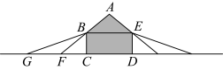

14. （25-26八年级上·北京西城·期末）如图是一个搭建好的帐篷从正面看的示意图，其中五边形$ABCDE$表示帐篷，线段$BF, BG$表示绳索，点$F$在$AB$的延长线上，且点$F, G$都在$DC$的延长线上．若$\angle ABC=130^{\circ}$，$\angle BCD=90^{\circ}$，$FG=FB$，则$\angle BGF=$ ___ $^{\circ}$．

> [!question]- 点击查看答案与解析
> 【答案】$20$
> 
> 【考点】等腰三角形的性质（等边对等角） → [[【初中数学知识点体系-人教版】#15-3 等腰三角形]]、三角形内角和与外角性质 → [[【初中数学知识点体系-人教版】#13-3 三角形的内角与外角]]
> 
> 【解析】
> ∵ 点 $F$ 在 $AB$ 的延长线上，$\angle ABC=130^{\circ}$，
> ∴ $\angle FBC=180^{\circ}-\angle ABC=180^{\circ}-130^{\circ}=50^{\circ}$。
> ∵ $\angle BCD=90^{\circ}$，在 $\triangle BFC$ 中，$\angle BFC=\angle BCD-\angle FBC=90^{\circ}-50^{\circ}=40^{\circ}$。
> ∵ $FG=FB$，∴ $\angle BGF=\angle FBG$；$\angle BFC$ 是 $\triangle FGB$ 的外角，$\angle BFC=\angle BGF+\angle FBG=2\angle BGF$，
> ∴ $\angle BGF=\frac{1}{2}\angle BFC=20^{\circ}$。
> 
> 【易错点】平角与邻补角的方向判断错误；等腰三角形等边对等角的对应角找错；外角等于不相邻两内角之和的关系用反。
