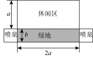

15. （25-26八年级上·北京西城·期末）如图，某街心公园有一块长为$2a\,\mathrm{m}$，宽为$b\,\mathrm{m}$的长方形绿地，绿地的北侧是一个长为$2a\,\mathrm{m}$，宽为$a\,\mathrm{m}$的长方形休闲区，绿地的东、西两侧各有一个边长为$b\,\mathrm{m}$的正方形喷泉区．已知休闲区的宽与绿地的宽的和为$13\,\mathrm{m}$，休闲区的面积与两个喷泉区的面积的和为$194\,\mathrm{m}^{2}$，那么绿地的面积为 ___ $\mathrm{m}^{2}$．

> [!question]- 点击查看答案与解析
> 【答案】$72$
> 
> 【考点】完全平方公式的几何应用 → [[【初中数学知识点体系-人教版】#16-3 乘法公式]]
> 
> 【解析】
> 休闲区面积为 $2a\cdot a=2a^{2}$，两个喷泉区面积之和为 $2b^{2}$。由题意：$a+b=13$，$2a^{2}+2b^{2}=194$，故 $a^{2}+b^{2}=97$。
> 由完全平方公式 $(a+b)^{2}=a^{2}+2ab+b^{2}$，得 $13^{2}=97+2ab$，$2ab=169-97=72$。
> 绿地为长 $2a$、宽 $b$ 的长方形，面积为 $2a\cdot b=2ab=72\,\mathrm{m}^{2}$。
> 
> 【易错点】绿地长为 $2a$、宽为 $b$，面积是 $2ab$ 而不是 $ab$；完全平方公式展开漏掉 $2ab$；本题不必硬求出 $a$、$b$ 的具体值。
