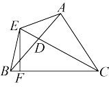
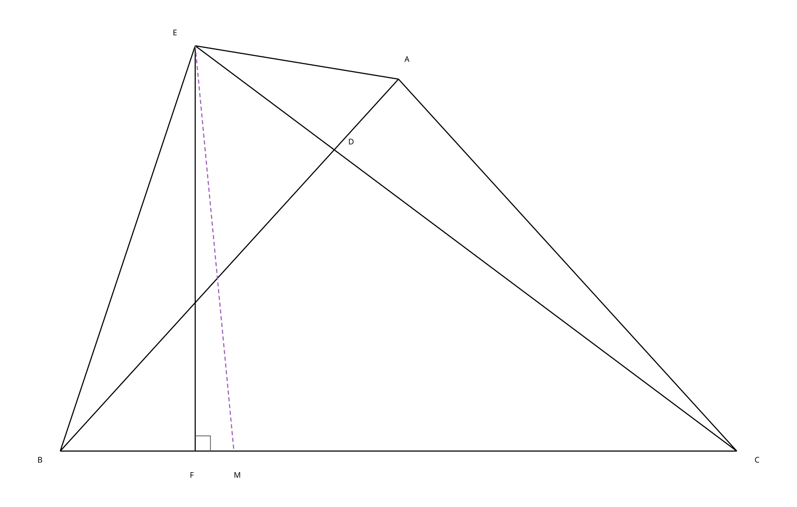

16. （25-26八年级上·北京西城·期末）如图，$CD$是$\triangle ABC$的角平分线，点$E$在$CD$的延长线上，$DC=AC$，$EC=BC$，$EF\perp BC$，垂足为$F$．有下列四个结论：$①$ $\triangle DAC$与$\triangle DBC$的面积相等；$②$ $\angle ADC=\angle BEC$；$③$ $2\angle AEC+3\angle BCE=180^{\circ}$；$④$ $FC=\frac{1}{2}(EC+DC)$．其中所有正确结论的序号是 ___ ．

> [!question]- 点击查看答案与解析
> 【答案】$②③④$
> 
> 【考点】全等三角形的判定与性质 → [[【初中数学知识点体系-人教版】#14-2 三角形全等的判定]]、角平分线的定义与等腰三角形性质 → [[【初中数学知识点体系-人教版】#14-3 角的平分线]]
> 
> 【解析】
> $①$：$\triangle DAC$ 与 $\triangle DBC$ 过点 $C$ 的高相同，但底边 $AD$ 与 $DB$ 不一定相等（$CD$ 是角平分线，不一定是中线），故面积不一定相等，$①$ 错误。
> $②$：∵ $CD$ 平分 $\angle ACB$，∴ $\angle ACD=\angle BCE$；又 $DC=AC$，$EC=BC$，∴ $\angle ADC=\angle CAD=\frac{1}{2}(180^{\circ}-\angle ACD)$，$\angle BEC=\angle CBE=\frac{1}{2}(180^{\circ}-\angle BCE)$，故 $\angle ADC=\angle BEC$，$②$ 正确。
> $③$：设 $\angle ADC=\angle CAD=\angle BEC=\angle CBE=x$，则 $\angle ACD=\angle BCE=180^{\circ}-2x$。在 $\triangle ACE$ 和 $\triangle DCB$ 中，$AC=DC$，$\angle ACE=\angle DCB$，$CE=CB$，∴ $\triangle ACE\cong\triangle DCB$（SAS），$AE=BD$；进一步可得 $BD=BE=AE$，从而 $\angle AEC=3x-180^{\circ}$。代入得 $2\angle AEC+3\angle BCE=2(3x-180^{\circ})+3(180^{\circ}-2x)=180^{\circ}$，$③$ 正确。
> $④$：在 $BC$ 上截取 $CM=CA$，连接 $EM$。由 $\angle ACD=\angle BCE$，$CE=CE$，可证 $\triangle ACE\cong\triangle MCE$（SAS），$AE=EM$；又 $EB=EM$，$EF\perp BC$，由三线合一得 $BF=FM$。于是 $CF=BC-BF=CM+MF=DC+BF$，故 $FC=\frac{1}{2}(BC-BF+DC+BF)=\frac{1}{2}(EC+DC)$，$④$ 正确。
> 综上，正确结论为 $②③④$。
> 
> 
> 【易错点】判断面积相等时只看高相同而忽略底边是否相等；等腰三角形等边对等角的对应关系写错；$④$ 需截取辅助线后借助全等与三线合一推导，不能凭直观判断。
