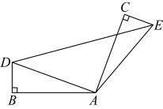

20. （25-26八年级上·北京西城·期末）如图，$AB=AC$，$DB\perp AB$，$EC\perp AC$，垂足分别为$B, C$，$\angle BAC=\angle DAE$．

(1) 求证：$AD=AE$；

(2) 若$\angle BAD=20^{\circ}$，$\angle DAE=110^{\circ}$，求$\angle CED$的度数．

> [!question]- 点击查看答案与解析
> 【答案】(1) 证明见解析，$AD=AE$；(2) $\angle CED=35^{\circ}$
> 
> 【考点】全等三角形的判定与性质 → [[【初中数学知识点体系-人教版】#14-2 三角形全等的判定]]
> 
> 【解析】
> (1) 证明：∵ $DB\perp AB$，$EC\perp AC$，∴ $\angle B=\angle C=90^{\circ}$。∵ $\angle BAC=\angle DAE$，∴ $\angle BAC-\angle DAC=\angle DAE-\angle DAC$，即 $\angle BAD=\angle CAE$。
> 在 $\triangle ABD$ 和 $\triangle ACE$ 中，$\angle B=\angle C$，$AB=AC$，$\angle BAD=\angle CAE$，∴ $\triangle ABD\cong\triangle ACE$（ASA），∴ $AD=AE$。
> (2) 解：由 $\angle CAE=\angle BAD=20^{\circ}$，在 $\mathrm{Rt}\triangle ACE$ 中，$\angle CEA=70^{\circ}$。∵ $AD=AE$，∴ $\angle ADE=\angle AED$；又 $\angle DAE=110^{\circ}$，∴ $\angle AED=(180^{\circ}-110^{\circ})\div 2=35^{\circ}$。于是 $\angle CED=\angle CEA-\angle AED=70^{\circ}-35^{\circ}=35^{\circ}$。
> 
> 【易错点】角的和差转化 $\angle BAD=\angle CAE$ 找不到中间公共角；全等对应顶点写乱；$\angle CED$ 是两角之差，误算成两角之和。
