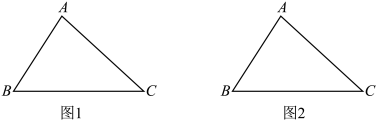
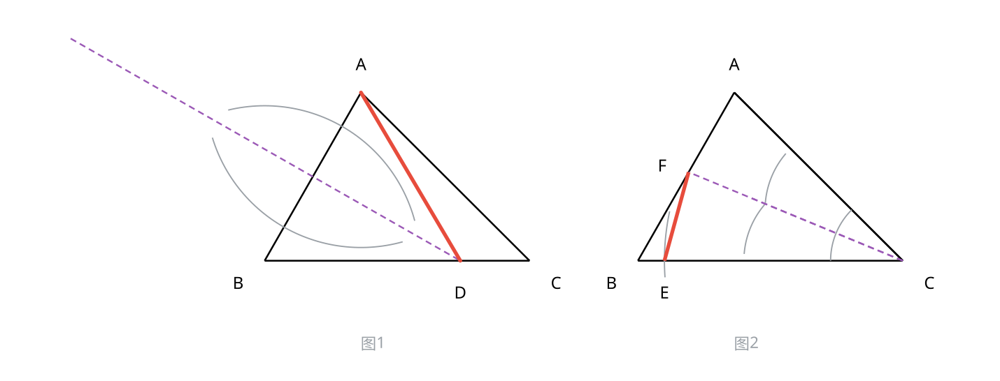

21. （25-26八年级上·北京西城·期末）已知在$\triangle ABC$中，$AB<AC<BC$．

(1) 如图1，在$\triangle ABC$的边$BC$上求作一点$D$，使$DA+DC=BC$．
$①$ 将下面的分析过程补充完整．
分析：点$D$在线段$BC$上，则$DB+$ ___ $=BC$，
而要使$DA+DC=BC$，即需要 ___ $=$ ___ ，
因此需要点$D$在线段 ___ 的垂直平分线上，
所以作出这条线段的垂直平分线，它与边$BC$的交点即为所求作的点$D$．
$②$ 用直尺和圆规在图1中完成作图并保留作图痕迹；

(2) 用直尺和圆规在图2中完成下列作图并保留作图痕迹：
在边$BC$上取一点$E$，使$CE=CA$；作$\angle ACB$的平分线交$AB$于点$F$，连接$EF$；

(3) 在（2）的条件下，图2中线段 ___ 与线段$AF$相等；若 $BC=a$，$AC=b$，$AB=c$，则 $\triangle BEF$ 的周长为 ___ （用含$a, b, c$的式子表示）．

> [!question]- 点击查看答案与解析
> 【答案】(1) $①$ $DC$、$DB$、$DA$、$AB$；$②$ 作 $AB$ 的垂直平分线交 $BC$ 于 $D$（作图略）；(2) 作图略；(3) $EF$，$a-b+c$
> 
> 【考点】线段垂直平分线的性质与尺规作图 → [[【初中数学知识点体系-人教版】#15-1 图形的轴对称]]、角平分线的尺规作图 → [[【初中数学知识点体系-人教版】#14-3 角的平分线]]、全等三角形的判定与性质 → [[【初中数学知识点体系-人教版】#14-2 三角形全等的判定]]
> 
> 【解析】
> (1) $①$ 点 $D$ 在线段 $BC$ 上，则 $DB+DC=BC$；要使 $DA+DC=BC$，即需要 $DA=DB$，因此点 $D$ 在线段 $AB$ 的垂直平分线上。作出 $AB$ 的垂直平分线，它与边 $BC$ 的交点即为所求作的点 $D$。
> (2) 如图，在 $BC$ 上截取 $CE=CA$；作 $\angle ACB$ 的平分线交 $AB$ 于点 $F$，连接 $EF$，保留作图痕迹。
> (3) 证明：由作图知 $\angle BCF=\angle ACF$，$CE=CA$，又 $CF=CF$，∴ $\triangle CEF\cong\triangle CAF$（SAS），∴ $EF=AF$。
> ∵ $BC=a$，$AC=b$，$AB=c$，∴ $BE=BC-CE=BC-AC=a-b$。$\triangle BEF$ 的周长 $=BE+BF+EF=BE+BF+AF=BE+AB=a-b+c$。
> 
> 
> 
> 【易错点】垂直平分线判定（到线段两端点距离相等）与角平分线作图混淆；全等后对应边 $EF=AF$ 找错；周长转化时把 $EF$ 替换为 $AF$，再与 $BF$ 合成 $AB$。
