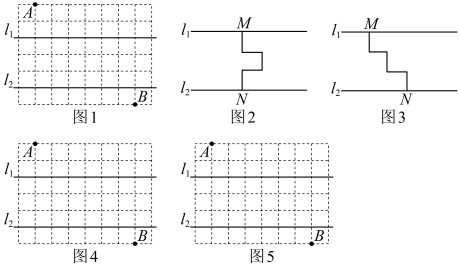

23. （25-26八年级上·北京西城·期末）如图1，公园里有一条河，河岸线可看成两条平行的直线$l_{1}, l_{2}$，河的宽度为$30\,\mathrm{m}$，景点 $A$ 和景点 $B$ 分别位于河的两岸（正方形网格中小正方形的边长为$10\,\mathrm{m}$，直线$l_{1}, l_{2}$都在网格线上，点 $A$，$B$ 都在网格线的交点上）．现要在河上造一座桥$MN$连通河的两岸，其中点$M, N$分别在直线$l_{1}, l_{2}$上．

(1)小明先将桥$MN$的桥形设计为一条线段，线段$MN$与直线$l_{1}$垂直，且使得从景点 $A$ 经桥$MN$走到景点 $B$ 的路径最短．他将点 $A$ 沿与直线$l_{1}$垂直的方向平移河的宽度得到点$A'$，从而将问题转化为在直线$l_{2}$上确定点 $N$ 的位置，使$A'N+NB$最小．请在图1中画出小明设计的桥$MN$（保留画图痕迹）；

(2)小明又将桥$MN$设计成Ⅰ型（如图2）和Ⅱ型（如图3）两种桥形，这两种桥形都是由五条$10\,\mathrm{m}$长的线段组成的折线，其中以点$M, N$为端点的两条线段分别与直线$l_{1}$，$l_{2}$垂直，且相邻两条线段互相垂直．
请在图4，图5中分别画出当采用Ⅰ型和Ⅱ型桥形时的桥$MN$，使得从景点 $A$ 经桥$MN$走到景点 $B$ 的路径最短（保留画图痕迹）；
比较图4，图5可知，采用 ___ 型桥形，最短路径的长度更短（填“Ⅰ”或“Ⅱ”）；

(3)小明以直线$l_{2}$为$x$轴，经过景点$A$且与直线$l_{2}$垂直的直线为$y$轴（分别取向右、向上为正方向），取 1 个单位长度代表$1\,\mathrm{m}$长，建立平面直角坐标系，景点 $A$ 的坐标为$(0, 50)$，另一景点$C$的坐标为$(t, -10)$．若无论采用（2）中的Ⅰ型或Ⅱ型桥形，从景点 $A$ 经桥$MN$走到景点 $C$ 的最短路径的长度相等，则 $t$ 的值为 ___ ．

> [!question]- 点击查看答案与解析
> 【答案】(1) 作图略；(2) $Ⅱ$；(3) $t=10$
> 
> 【考点】轴对称（平移）求最短路径——造桥选址 → [[【初中数学知识点体系-人教版】#15-1 图形的轴对称]]、平面直角坐标系中的平移与垂直平分线 → [[【初中数学知识点体系-人教版】#9-2 坐标方法的简单应用]]
> 
> 【解析】
> (1) 将点 $A$ 沿与 $l_{1}$ 垂直的方向平移河宽 $30\,\mathrm{m}$ 得到点 $A'$，连接 $A'B$ 交 $l_{2}$ 于点 $N$，过 $N$ 作 $NM\perp l_{1}$ 于点 $M$，$MN$ 即为所求桥。
> (2) Ⅰ型：平移 $A$ 得 $A'$，连接 $A'B$ 交 $l_{2}$ 于 $N$，再从 $N$ 按Ⅰ型折线反向作出点 $M$；Ⅱ型同理（水平方向再平移 $2$ 格得 $A''$）。比较图4、图5：Ⅰ型 $AM+BN=A'B$，Ⅱ型 $AM+BN=A''B<A'B$，故采用 $Ⅱ$ 型桥形，最短路径更短。
> (3) 类比 (2)，两型从 $M$ 到 $N$ 的距离都相等，Ⅰ型路径长 $AM+CN=A'C$，Ⅱ型路径长 $AM+CN=A''C$。两型最短路径长度相等，故 $A'C=A''C$，即 $C(t,-10)$ 在线段 $A'A''$ 的垂直平分线上。由 $A(0,50)$ 得 $A'(0,20)$，$A''(20,20)$，$A'A''$ 的垂直平分线为直线 $x=10$，故 $t=10$。
> 
> 【易错点】造桥问题应先平移定点、再连线段找交点；折线桥形的平移方向与格数对应不清；垂直平分线上的点到线段两端距离相等这一条件用反。
