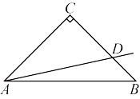
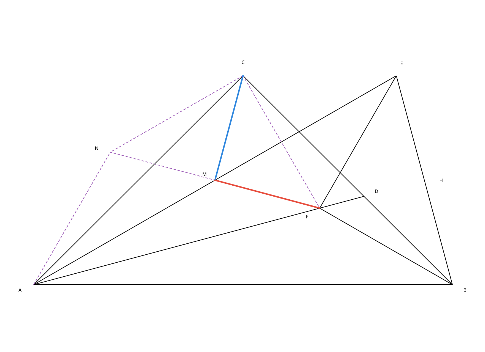

24. （25-26八年级上·北京西城·期末）如图，在$\triangle ABC$中，$CA=CB$，$\angle ACB=90^{\circ}$，射线$AD$与边$BC$交于点$D$，$\angle BAD=\alpha(0^{\circ}<\alpha<22.5^{\circ})$．点$E$与点$B$关于直线$AD$对称，线段$BE$与射线$AD$交于点$H$，点$F$在线段$AH$上，且$\angle BEF=45^{\circ}$，连接$BF$．

(1)依题意补全图形，并求$\angle ABF$的度数（用含$\alpha$的式子表示）；

(2)连接$AE$，$M$是$AE$的中点，连接$CM, FM$，探究线段$CM$与$FM$的数量关系和位置关系，并证明你的结论．

> [!question]- 点击查看答案与解析
> 【答案】(1) $\angle ABF=45^{\circ}-\alpha$；(2) $CM=FM$，$CM\perp FM$，证明见解析
> 
> 【考点】轴对称的性质 → [[【初中数学知识点体系-人教版】#15-1 图形的轴对称]]、全等三角形的判定与性质（倍长中线） → [[【初中数学知识点体系-人教版】#14-2 三角形全等的判定]]
> 
> 【解析】
> (1) ∵ 点 $E$ 与点 $B$ 关于直线 $AD$ 对称，∴ 直线 $AD$ 垂直平分 $BE$，$\angle AHB=90^{\circ}$，$FB=FE$。∴ $\angle EBF=\angle BEF=45^{\circ}$，$\angle BFH=45^{\circ}$。又 $\angle BAD=\alpha$，∴ $\angle ABF=\angle BFH-\angle BAD=45^{\circ}-\alpha$。
> (2) 结论：$CM=FM$，$CM\perp FM$。
> 证明：延长 $FM$ 至点 $N$，使 $MN=MF$，连接 $AN$、$CN$、$CF$。∵ $M$ 是 $AE$ 的中点，∴ $MA=ME$；又 $\angle AMN=\angle EMF$，$MN=MF$，∴ $\triangle MAN\cong\triangle MEF$（SAS），$AN=EF$，$\angle MAN=\angle MEF$，故 $AN=BF$。
> 由 $CA=CB$，$\angle ACB=90^{\circ}$，得 $\angle CAB=\angle CBA=45^{\circ}$；由对称得 $\angle EAF=\angle BAF=\alpha$，$\angle AEF=\angle ABF=45^{\circ}-\alpha$，可推得 $\angle NAC=\angle FBC=\alpha$。
> 在 $\triangle ACN$ 和 $\triangle BCF$ 中，$AC=BC$，$\angle NAC=\angle FBC$，$AN=BF$，∴ $\triangle ACN\cong\triangle BCF$（SAS），$CN=CF$，$\angle ACN=\angle BCF$，∴ $\angle NCF=\angle ACB=90^{\circ}$。∵ $MN=MF$，由等腰三角形三线合一得 $CM\perp FM$，且 $\angle MCF=\angle CFM=45^{\circ}$，∴ $CM=FM$。
> 
> 
> 【易错点】对称性质（垂直平分、对应线段相等）遗漏；倍长中线构造全等时辅助点 $N$ 与对应边找错；$\angle NCF=\angle ACB$ 的角的和差转化不清；等腰直角三角形三线合一同时得到垂直与等长。
