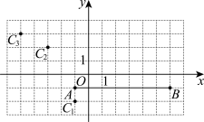

26. （25-26八年级上·北京西城·期末）在平面直角坐标系$xOy$中，对于直线 $l$，线段$AB$和点 $C$，给出如下定义：记点 $C$ 关于直线 $l$ 的对称点为$C'$，若线段$AB$上存在点 $M$，$N$，使得$C'M=C'N$，且$\angle MC'N=\alpha$，则称点 $C$ 是线段$AB$的“$l-\alpha$可及点”．

(1)如图，直线 $l$ 为 $y$ 轴，点$A(-1, -1)$，$B(6, -1)$．在点$C_{1}(-1, -2)$，$C_{2}(-3, 2)$，$C_{3}(-5, 3)$中，线段$AB$的“$l-90^{\circ}$可及点”是 ___ ；

(2)已知点$D(-6, -1)$，$E(-2, -5)$，直线$l$经过点$(-1, 0)$且垂直于 $x$ 轴，点$F(0, m)$，$G(4, m+4)$．若线段$DE$上存在线段$FG$的“$l-90^{\circ}$可及点”，直接写出 $m$ 的取值范围；

(3)已知$\triangle STR$是等边三角形，其三个顶点的坐标分别为$S(-4, 0)$，$T(-2, 0)$，$R(-3, \sqrt{3})$，直线 $l$ 经过点$(t, 0)$且垂直于 $x$ 轴，点$P(n, -\sqrt{3})$，$Q(n+8, -\sqrt{3})$．当$-1\leq t\leq 0$时，对于 $t$ 的每一个值，$\triangle STR$的三条边上的所有点都是线段$PQ$的“$l-60^{\circ}$可及点”，直接写出 $n$ 的取值范围．

> [!question]- 点击查看答案与解析
> 【答案】(1) $C_{1}$，$C_{2}$；(2) $-9\leq m\leq -1$ 且 $m\neq -5$；(3) $-3\leq n\leq -1$
> 
> 【考点】关于竖直线（坐标轴）对称的点的坐标 → [[【初中数学知识点体系-人教版】#15-1 图形的轴对称]]、平面直角坐标系中点的位置与新定义综合 → [[【初中数学知识点体系-人教版】#9-1 用坐标描述平面内点的位置]]
> 
> 【解析】
> 定义翻译：点 $C$ 关于直线 $l$ 的对称点记为 $C'$；若线段 $AB$ 上存在点 $M$、$N$，使 $C'M=C'N$ 且 $\angle MC'N=\alpha$，则 $C$ 是 $AB$ 的“$l-\alpha$ 可及点”。即把 $C'$ 作为等腰（顶角为 $\alpha$）三角形的顶点，两腰端点落在 $AB$ 上。
> (1) $l$ 为 $y$ 轴，对称点纵坐标不变、横坐标相反。分别作 $C_{1}$、$C_{2}$、$C_{3}$ 关于 $y$ 轴的对称点，检验以对称点为直角顶点的等腰直角三角形两腰端点能否落在线段 $AB$ 上。符合条件的是 $C_{1}$、$C_{2}$。
> (2) $l$ 经过 $(-1,0)$ 且垂直于 $x$ 轴，即 $l:x=-1$。以 $FG$ 为底边作等腰直角 $\triangle FMG$ 与 $\triangle FNG$；线段 $DE$ 上存在“可及点”，等价于 $DE$ 关于 $l$ 的对称线段 $D'E'$ 与正方形 $FMGN$ 有交点。$E(-2,-5)$ 对称得 $E'(0,-5)$，$D(-6,-1)$ 对称得 $D'(4,-1)$。端点 $N$ 与 $D'$ 重合时 $m=-1$；端点 $M$ 与 $E'$ 重合时 $m+4=-5$，$m=-9$；$FG$ 与 $E'D'$ 重合时 $m=-5$（此时退化，舍去）。综上 $-9\leq m\leq -1$ 且 $m\neq -5$。
> (3) 当 $-1\leq t\leq 0$ 时，将 $\triangle STR$ 分别关于直线 $t=-1$ 与 $y$ 轴对称，得到两侧的等边三角形；以 $PQ$ 为边的等边 $\triangle PQH$ 需全部包含这些三角形。临界位置：$HQ$ 过边 $R'S''$ 时，$n+8=4+1$，解得 $n=-3$；$HP$ 过边 $OR$ 时，$n=0-1=-1$。故 $-3\leq n\leq -1$。
> 
> 【易错点】新定义未翻译成“对称点 + 等腰顶角三角形两腰落在目标线段上”；第（2）问漏掉 $m=-5$ 退化重合需舍去；第（3）问两侧对称三角形的临界位置与包含关系判断不清，漏写端点范围。
