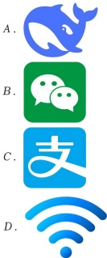

---
id: MAT-8-1-20260829-001-Q01
source: "[[八上-数学-2026北京交大附中期中-20260829#1.]]"
knowledge: ["15-1 图形的轴对称"]
tags: ["八上数学"]
---

1. （3分）下列图标是轴对称图形的是（）

> [!question]- 点击查看答案与解析
> 【答案】D
> 
> 【考点】轴对称图形的识别 → [[【初中数学知识点体系-人教版】#15-1 图形的轴对称]]
> 
> 【解析】
> - 轴对称图形是指沿一条直线折叠后，直线两旁的部分能够互相重合的图形；
> - 选项D：该图标可以沿竖直方向的直线折叠，左右两部分完全重合，是轴对称图形，正确；
> - 选项B：该图标找不到一条直线使其折叠后两部分重合，不是轴对称图形，错误；
> - 选项C：该图标找不到一条直线使其折叠后两部分重合，不是轴对称图形，错误；
> - 选项A：该图标找不到一条直线使其折叠后两部分重合，不是轴对称图形，错误。
> 
> 【易错点】混淆轴对称图形与中心对称图形，判断时需明确"沿直线折叠后两旁部分重合"这一核心特征。
