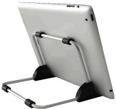

---
id: MAT-8-1-20260829-001-Q02
source: "[[八上-数学-2026北京交大附中期中-20260829#2.]]"
knowledge: ["13-1 三角形的稳定性"]
tags: ["八上数学"]
---

2. （3分）平板是我们日常生活中经常使用的电子产品，它的很多保护壳还兼具支架功能，有一种如图，平板电脑放在上面就可以很方便地使用了，这里应用的几何原理是（）

A. 三角形的稳定性

B. 两点之间线段最短

C. 两点确定一条直线

D. 三角形两边之和大于第三边

> [!question]- 点击查看答案与解析
> 【答案】A
> 
> 【考点】三角形的稳定性在实际生活中的应用 → [[【初中数学知识点体系-人教版】#13-1 三角形的概念]]
> 
> 【解析】
> - 选项A：平板电脑保护壳的支架结构中，保护壳背面与桌面、支撑杆构成了三角形，利用了三角形具有稳定性（三边确定后形状不变）的原理，使平板能稳定地保持一定角度，正确；
> - 选项B："两点之间线段最短"用于求最短距离问题，与支架的稳固性无关，错误；
> - 选项C："两点确定一条直线"用于确定直线的位置，与支架的稳固性无关，错误；
> - 选项D："三角形两边之和大于第三边"用于判断三边能否构成三角形，不是支架设计的原理，错误。
> 
> 【易错点】不能从实际生活情境中抽象出三角形结构，误选与"距离"或"直线"相关的选项。
