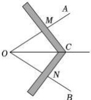

---
id: MAT-8-1-20260829-001-Q05
source: "[[八上-数学-2026北京交大附中期中-20260829#5.]]"
knowledge: ["14-2 三角形全等的判定"]
tags: ["八上数学"]
---

5. （3分）如图，在综合实践课上，老师用角尺在 $\angle AOB$ 的两边分别截取 $OM=ON$，移动角尺，使角尺两边相同的刻度分别与点 $M$，$N$ 重合，这时 $OC$ 就是 $\angle AOB$ 的平分线，则用角尺作角平分线的过程中用到的三角形全等的依据（ ）

A. $HL$

B. $SSS$

C. $SAS$

D. $ASA$

> [!question]- 点击查看答案与解析
> 【答案】B
> 
> 【考点】三角形全等的判定（SSS）、角平分线的性质 → [[【初中数学知识点体系-人教版】#14-2 三角形全等的判定]]
> 
> 【解析】
> - 由题意可知：$OM=ON$（在角的两边截取的等长线段），$MC=NC$（角尺两边相同的刻度），$OC=OC$（公共边）；
> - 在 $\triangle OMC$ 和 $\triangle ONC$ 中，三组对应边分别相等：$OM=ON$，$MC=NC$，$OC=OC$；
> - 因此 $\triangle OMC\cong\triangle ONC$（SSS），从而 $\angle MOC=\angle NOC$，即 $OC$ 是 $\angle AOB$ 的平分线；
> - 选项A：$HL$ 仅适用于直角三角形，本题不涉及直角条件，错误；
> - 选项C：$SAS$ 需要两边及其夹角对应相等，本题已知条件是三边，错误；
> - 选项D：$ASA$ 需要两角及其夹边对应相等，本题已知条件是三边，错误。
> 
> 【易错点】不能从实际操作中抽象出三角形全等的条件，混淆 SSS、SAS、ASA 等判定方法的适用场景。
