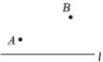
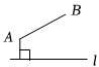
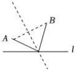
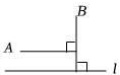
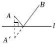

---
id: MAT-8-1-20260829-001-Q06
source: "[[八上-数学-2026北京交大附中期中-20260829#6.]]"
knowledge: ["15-1 图形的轴对称"]
tags: ["八上数学"]
---

6. （3分）如图，直线是一条河，$A$、$B$ 是两个新农村定居点。欲在 $l$ 上的某点处修建一个水泵站，由水泵站直接向 $A$、$B$ 两地供水。现有如下四种管道铺设方案，图中实线表示铺设的供水管道，则铺设管道最短的方案是（ ）

A.

B.

C.

D.

> [!question]- 点击查看答案与解析
> 【答案】B
> 
> 【考点】轴对称的应用——最短路径问题 → [[【初中数学知识点体系-人教版】#15-1 图形的轴对称]]
> 
> 【解析】
> - 本题考查"将军饮马"模型，利用轴对称求最短路径；
> - 作点 $A$ 关于直线 $l$ 的对称点 $A'$，连接 $A'B$ 交直线 $l$ 于点 $P$，则 $PA+PB=PA'+PB=A'B$ 最短；
> - 选项A：直接从 $A$、$B$ 向 $l$ 作垂线，不是最短路径；
> - 选项B：利用轴对称原理，作 $A$ 关于 $l$ 的对称点后连接 $B$，交点即为水泵站位置，管道最短，正确；
> - 选项C：连接方式不符合轴对称最短路径原理；
> - 选项D：连接方式不符合轴对称最短路径原理。
> 
> 【易错点】不能正确识别"将军饮马"模型，需掌握"作对称点→连线→求交点"的解题步骤。
