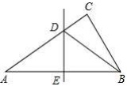

---
id: MAT-8-1-20260829-001-Q07
source: "[[八上-数学-2026北京交大附中期中-20260829#7.]]"
knowledge: ["13-2 与三角形有关的线段"]
tags: ["八上数学"]
---

7. （3分）如图，在 $\triangle ABC$ 中，$DE$ 垂直平分 $AB$，交边 $AC$ 于点 $D$，交边 $AB$ 于点 $E$，连接 $BD$。若 $AC=6$，$\triangle BCD$ 的周长为 $10$，则 $BC$ 的长为（ ）

A. $2$

B. $4$

C. $6$

D. $8$

> [!question]- 点击查看答案与解析
> 【答案】B
> 
> 【考点】线段垂直平分线的性质 → [[【初中数学知识点体系-人教版】#13-2 与三角形有关的线段]]
> 
> 【解析】
> - 因为 $DE$ 垂直平分 $AB$，所以 $DA=DB$（线段垂直平分线上的点到线段两端点的距离相等）；
> - $\triangle BCD$ 的周长 $=BC+CD+BD=10$；
> - 因为 $DA=DB$，所以 $BC+CD+DA=10$；
> - 又因为 $CD+DA=AC=6$，所以 $BC+6=10$；
> - 因此 $BC=4$，选 B。
> 
> 【易错点】不能正确运用线段垂直平分线的性质将 $BD$ 转化为 $AD$，导致无法建立等量关系。
