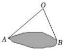

---
id: MAT-8-1-20260829-001-Q08
source: "[[八上-数学-2026北京交大附中期中-20260829#8.]]"
knowledge: ["13-2 与三角形有关的线段"]
tags: ["八上数学"]
---

8. （3分）如图，为估计池塘岸边 $A$、$B$ 两点的距离，小方在池塘的一侧选取一点 $O$，测得 $OA=7$ 米，$OB=5$ 米，$A$、$B$ 间的距离可能是（ ）

A. $15$ 米

B. $13$ 米

C. $1$ 米

D. $9$ 米

> [!question]- 点击查看答案与解析
> 【答案】D
> 
> 【考点】三角形三边关系 → [[【初中数学知识点体系-人教版】#13-1 三角形的概念]]
> 
> 【解析】
> - 在 $\triangle AOB$ 中，根据三角形三边关系：$|OA-OB| < AB < OA+OB$；
> - 代入数据：$|7-5| < AB < 7+5$，即 $2 < AB < 12$；
> - 选项A：$15 > 12$，不符合；
> - 选项B：$13 > 12$，不符合；
> - 选项C：$1 < 2$，不符合；
> - 选项D：$9$ 在 $(2, 12)$ 范围内，符合，选 D。
> 
> 【易错点】忽略三角形三边关系的限制条件，不能正确建立不等式 $|OA-OB| < AB < OA+OB$。
