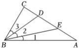

---
id: MAT-8-1-20260829-001-Q09
source: "[[八上-数学-2026北京交大附中期中-20260829#9.]]"
knowledge: ["13-2 与三角形有关的线段"]
tags: ["八上数学"]
---

9. （3分）如图，在 $\triangle ABC$ 中，$\angle C=90^\circ$，$D$，$E$ 是边 $AC$ 上两点，$AE=DE$，$BD$ 平分 $\angle EBC$，下列说法中不正确的是（ ）

A. $BE$ 是 $\triangle ABD$ 的中线

B. $BD$ 是 $\triangle BCE$ 的角平分线

C. $\angle 1=\angle 2=\angle 3$

D. $BC$ 是 $\triangle ABE$ 的高

> [!question]- 点击查看答案与解析
> 【答案】C
> 
> 【考点】三角形的中线、角平分线、高 → [[【初中数学知识点体系-人教版】#13-2 与三角形有关的线段]]
> 
> 【解析】
> - 因为 $AE=DE$，所以 $E$ 是 $AD$ 的中点，因此 $BE$ 是 $\triangle ABD$ 的中线，A 正确；
> - 因为 $BD$ 平分 $\angle EBC$，所以 $BD$ 是 $\triangle BCE$ 的角平分线，B 正确；
> - $\angle 1$ 和 $\angle 2$ 不一定相等，因为 $BD$ 平分 $\angle EBC$ 只能得到 $\angle 2=\angle 3$，但 $\angle 1$ 与它们无关，C 不正确；
> - 因为 $\angle C=90^\circ$，所以 $BC\perp AC$，即 $BC\perp AE$，因此 $BC$ 是 $\triangle ABE$ 的高，D 正确。
> 
> 【易错点】混淆三角形中线、角平分线、高的定义，不能准确判断各线段的性质。
