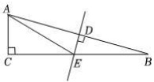

---
id: MAT-8-1-20260829-001-Q12
source: "[[八上-数学-2026北京交大附中期中-20260829#12.]]"
knowledge: ["13-2 与三角形有关的线段", "15-3 等腰三角形"]
tags: ["八上数学"]
---

12. （2分）如图，在 $Rt\triangle ABC$ 中，$AB$ 的垂直平分线交 $BC$ 边于点 $E$。若 $\angle B=15^{\circ}$，则 $\angle CAE=$ ___ 度。

> [!question]- 点击查看答案与解析
> 【答案】$60$
> 
> 【考点】线段垂直平分线的性质、直角三角形两锐角互余 → [[【初中数学知识点体系-人教版】#13-2 与三角形有关的线段]]
> 
> 【解析】
> 在 $Rt\triangle ABC$ 中，$\angle C=90^{\circ}$，$\angle B=15^{\circ}$，
> 所以 $\angle BAC=90^{\circ}-15^{\circ}=75^{\circ}$。
> 
> 因为 $E$ 在 $AB$ 的垂直平分线上，所以 $EA=EB$，
> 所以 $\angle EAB=\angle B=15^{\circ}$。
> 
> 因此 $\angle CAE=\angle BAC-\angle EAB=75^{\circ}-15^{\circ}=60^{\circ}$。
> 
> 【易错点】忽略垂直平分线性质导致 $EA=EB$，无法求出 $\angle EAB$。
