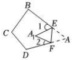

---
id: MAT-8-1-20260829-001-Q13
source: "[[八上-数学-2026北京交大附中期中-20260829#13.]]"
knowledge: ["15-1 图形的轴对称"]
tags: ["八上数学"]
---

13. （2分）将四边形纸片 $ABCD$ 沿 $EF$ 折叠，点 $A$ 落在 $A_{1}$ 处，若 $\angle 1+\angle 2=100^{\circ}$，则 $\angle A$ 的度数是 ___ 。

> [!question]- 点击查看答案与解析
> 【答案】$50^{\circ}$
> 
> 【考点】折叠的性质、四边形内角和 → [[【初中数学知识点体系-人教版】#15-1 图形的轴对称]]
> 
> 【解析】
> 由折叠性质可知：$\angle A=\angle A_{1}$。
> 
> 设 $\angle AEF=\alpha$，$\angle AFE=\beta$，则折叠后 $\angle A_{1}EF=\alpha$，$\angle A_{1}FE=\beta$。
> 
> 所以 $\angle 1=180^{\circ}-2\alpha$，$\angle 2=180^{\circ}-2\beta$。
> 
> $\angle 1+\angle 2=360^{\circ}-2(\alpha+\beta)=100^{\circ}$
> 
> 所以 $\alpha+\beta=130^{\circ}$。
> 
> 在 $\triangle AEF$ 中，$\angle A=180^{\circ}-(\alpha+\beta)=180^{\circ}-130^{\circ}=50^{\circ}$。
> 
> 【易错点】不能正确利用折叠的对称性建立 $\angle 1$、$\angle 2$ 与 $\angle A$ 的关系。
