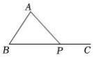

---
id: MAT-8-1-20260829-001-Q15
source: "[[八上-数学-2026北京交大附中期中-20260829#15.]]"
knowledge: ["15-3 等腰三角形", "13-3 三角形的内角与外角"]
tags: ["八上数学"]
---

15. （2分）如图，已知 $\angle ABC=50^{\circ}$，$P$ 是射线 $BC$ 上的一个动点，若 $\triangle ABP$ 为等腰三角形，则 $\angle APC$ 的度数为 ___ 。

> [!question]- 点击查看答案与解析
> 【答案】$50^{\circ}$ 或 $65^{\circ}$ 或 $80^{\circ}$
> 
> 【考点】等腰三角形的分类讨论 → [[【初中数学知识点体系-人教版】#15-3 等腰三角形]]
> 
> 【解析】
> 因为 $P$ 在射线 $BC$ 上，所以 $B$、$C$、$P$ 共线，且 $PB$ 与 $PC$ 方向相同，因此 $\angle APC = \angle APB$。
> 
> $\triangle ABP$ 为等腰三角形，分三种情况讨论：
> 
> **情况一**：$AB=AP$（$A$ 为顶点）
> $\angle APB = \angle ABP = 50^{\circ}$，所以 $\angle APC = 50^{\circ}$。
> 
> **情况二**：$BA=BP$（$B$ 为顶点）
> $\angle BAP = \angle BPA$，$\angle ABP = 50^{\circ}$，
> $\angle BPA = \frac{180^{\circ} - 50^{\circ}}{2} = 65^{\circ}$，所以 $\angle APC = 65^{\circ}$。
> 
> **情况三**：$PA=PB$（$P$ 为顶点）
> $\angle PAB = \angle PBA = 50^{\circ}$，
> $\angle APB = 180^{\circ} - 50^{\circ} - 50^{\circ} = 80^{\circ}$，所以 $\angle APC = 80^{\circ}$。
> 
> 综上，$\angle APC$ 的度数为 $50^{\circ}$ 或 $65^{\circ}$ 或 $80^{\circ}$。
> 
> 【易错点】遗漏分类讨论的情况，只考虑一种等腰情况而忽略其他两种。
